# ENEM 2026 — 2º dia — Caderno 5 · Amarelo

**Prova de Ciências da Natureza e suas Tecnologias** (questões 91 a 135) e
**Prova de Matemática e suas Tecnologias** (questões 136 a 180).

Transcrição do caderno escaneado (fonte: "ENEM 2 dia - Prova Amarela Anglo Resolve.pdf"). Figuras recortadas da prova
original em `imagens/`. Fórmulas em LaTeX (`$...$`).

---

# Ciências da Natureza e suas Tecnologias — Questões de 91 a 135

## Questão 91

O modelo de Rutherford para o átomo consiste em um núcleo bastante denso, pequeno e carregado positivamente, ao redor do qual orbitam partículas negativas. A interação atrativa entre o núcleo e os elétrons foi explicada posteriormente pela existência de uma força centrípeta de origem elétrica, cujo módulo, segundo a lei de Coulomb, é proporcional à constante eletrostática e ao quadrado da carga elementar, e inversamente proporcional ao quadrado da distância entre o núcleo e os elétrons. No entanto, o modelo planetário proposto por Rutherford não concorda com a teoria eletromagnética clássica, segundo a qual os elétrons descreveriam um movimento em espiral e se chocariam com o núcleo, o que não corresponde à realidade.

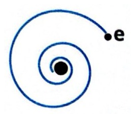

Qual gráfico apresenta a força de atração entre o núcleo e o elétron, em função do tempo para o átomo de hidrogênio, levando em consideração a teoria eletromagnética clássica?

**A)** 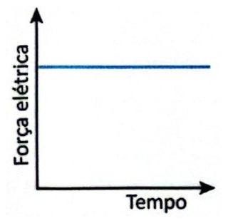

**B)** 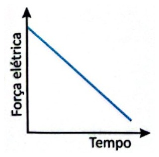

**C)** 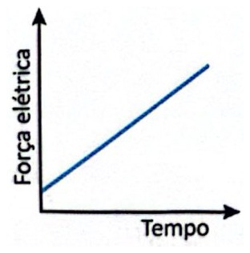

**D)** 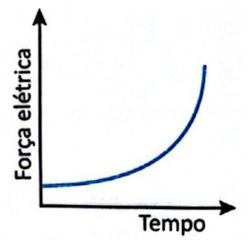

**E)** 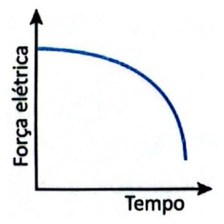

## Questão 92

O quadro lista o resultado da simulação feita por uma engenheira para dimensionar as fontes de calor no interior de um escritório onde trabalham 20 pessoas. Todos os equipamentos e as pessoas dissipam calor de acordo com os valores no quadro. Para manter constante a temperatura do escritório, ela precisa de um aparelho de ar-condicionado o mais econômico possível. Considere as paredes isolantes e o fator de conversão 1 Btu/h = 0,3 W.

| Fonte de calor | Quantidade | Potência individual (W) |
|---|---|---|
| Lâmpada | 10 | 100 |
| Computador | 20 | 150 |
| Geladeira | 2 | 500 |
| Pessoa adulta | 20 | 200 |

Qual é a capacidade de refrigeração, em British thermal unit por hora, do aparelho selecionado?

**A)** 7 000 Btu/h

**B)** 10 000 Btu/h

**C)** 12 000 Btu/h

**D)** 24 000 Btu/h

**E)** 30 000 Btu/h

## Questão 93

**Resíduos sólidos urbanos**

Segundo a Associação Brasileira de Resíduos e Meio Ambiente, em 2022, foram geradas cerca de 211 mil toneladas de resíduos sólidos urbanos (RSU) por dia no país. Aproximadamente 93% desses resíduos são coletados, o que equivale a 196 mil toneladas de RSU por dia. Desse montante, os resíduos secos recicláveis representam 34%, e os resíduos orgânicos são a maioria e representam 45% do total coletado. A situação parece sob controle, se desconsiderarmos que 40% dos RSU coletados são dispostos irregularmente em lixões ou a céu aberto, enquanto 60% é encaminhado para aterros sanitários.

Nos aterros sanitários, parte dos RSU podem ser utilizados na produção de biogás para alimentar usinas termelétricas. Cerca de 20 kg de resíduos orgânicos produzem 1 metro cúbico de biogás, o qual pode gerar 1,2 kWh de energia elétrica.

> Disponível em: www.abrema.org.br. Acesso em: 9 abr. 2026 (adaptado).

Se todos os resíduos orgânicos coletados fossem utilizados para geração de biogás, aproximadamente quanta energia elétrica, em quilowatt-hora, poderia ser gerada por dia?

**A)** $1{,}2 \times 10^{7}$ kWh

**B)** $7{,}1 \times 10^{6}$ kWh

**C)** $5{,}3 \times 10^{6}$ kWh

**D)** $3{,}2 \times 10^{6}$ kWh

**E)** $2{,}1 \times 10^{6}$ kWh

## Questão 94

Em um reator de fusão nuclear, é necessário produzir plasma a um milhão de graus centígrados para desencadear reações de fusão nuclear controladas. O plasma é formado por um gás ionizado que contém inicialmente deutério $D^{+}$ e trítio $T^{+}$ (isótopos do hidrogênio, com um e dois nêutrons, respectivamente). Nesse plasma, a energia térmica é suficientemente alta para desencadear uma reação de fusão nuclear na qual o núcleo do deutério, partícula $D^{+}$, e o núcleo de trítio, partícula $T^{+}$, colidem para formar uma partícula $\alpha$ e um nêutron *n*. A representação dessa reação de fusão é

$$D^{+} + T^{+} \longrightarrow \alpha + n$$

A partícula $\alpha$ é formada por dois prótons e dois nêutrons. A energia liberada pela fusão é dividida na forma de energia cinética entre a partícula $\alpha$ e o nêutron *n*. Considere as massas do próton e do nêutron iguais, que o momento linear total das partículas reagentes é nulo e também que a energia cinética dos produtos é de 20 MeV.

> Disponível em: www.scientificamerican.com. Acesso em: 11 nov. 2019 (adaptado).

Nessa reação de fusão, a energia cinética do nêutron, em megaelétron-volt, é

**A)** 4,0 MeV.

**B)** 10 MeV.

**C)** 13 MeV.

**D)** 15 MeV.

**E)** 16 MeV.

## Questão 95

A mudança da resistência elétrica de alguns materiais em função da temperatura é utilizada para construir sensores que podem medir desde a temperatura ambiente até a de fornos. A figura representa um circuito elétrico usado para fazer a correspondência entre temperatura e tensão elétrica, na qual a resistência elétrica $R_s$ varia com a temperatura segundo a expressão $R_s = 20[1 + 0{,}002(T - 300)]$. A temperatura é medida em Kelvin.

A tensão elétrica, em volt, entre os pontos **A** e **B** da figura, quando o sensor estiver à temperatura de 800 K é de

**A)** 5,0 V.

**B)** 4,0 V.

**C)** 3,0 V.

**D)** 2,0 V.

**E)** 1,0 V.

## Questão 96

Uma instalação de radar, usada para rastrear aviões, emite ondas eletromagnéticas com velocidade estimada de 300 mil quilômetros por segundo. Um avião que saiu da rota foi localizado em um raio de 75 quilômetros do aeroporto onde fica o radar. O operador usou o tempo dispendido para enviar e receber a resposta com a finalidade de estimar a localização do avião.

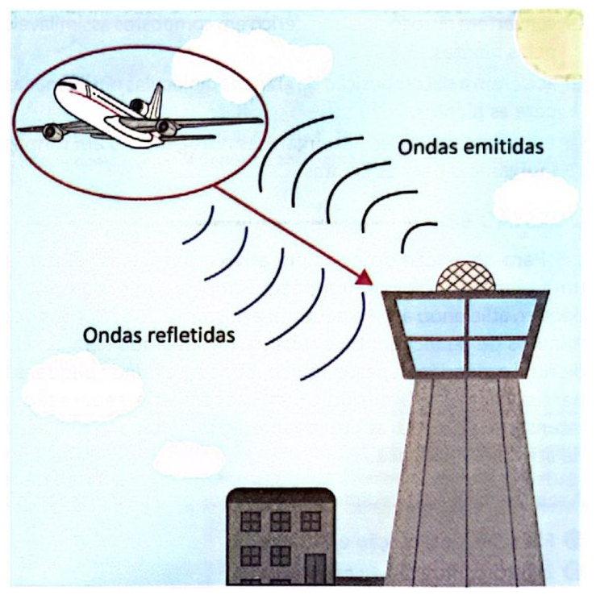

> Disponível em: www.pasternack.com. Acesso em: 1 abr. 2026 (adaptado).

O tempo, em segundo, medido foi de

**A)** $2{,}0 \times 10^{3}$ s.

**B)** $4{,}0 \times 10^{0}$ s.

**C)** $5{,}0 \times 10^{-1}$ s.

**D)** $1{,}5 \times 10^{-3}$ s.

**E)** $5{,}0 \times 10^{-4}$ s.

## Questão 97

A cientista brasileira Mariangela Hungria, pesquisadora da Embrapa Soja, foi laureada em 2025 com o Prêmio Mundial de Alimentação, o World Food Prize (WFP), reconhecido como o “Nobel” da agricultura. Sua pesquisa inclui plantas cultivadas, como a soja, inoculadas com bactérias simbióticas que formam nódulos em suas raízes. Graças a essas associações, os agricultores têm gastos menores com fertilizantes nitrogenados.

> LANDGRAF, Lebna. Disponível em: www.embrapa.br. Acesso em: 8 abr. 2026 (adaptado).

Essa economia acontece porque os microrganismos citados

**A)** auxiliam o processo de absorção de nitritos do solo pelas plantas.

**B)** capturam íons de nitrogênio em formas orgânicas absorvíveis pelas plantas.

**C)** convertem nitrogênio atmosférico em compostos assimiláveis pelas plantas.

**D)** aceleram a decomposição de grandes moléculas nitrogenadas para as plantas.

**E)** transformam moléculas orgânicas nitrogenadas em formas inorgânicas para as plantas.

## Questão 98

Para obtenção do princípio ativo a partir das folhas de uma planta medicinal, um pesquisador as colocou em um béquer, adicionou água e aqueceu a mistura a 100 °C. Após dez minutos de aquecimento, a mistura foi separada com auxílio de funil e algodão. A parte líquida, por conter ainda pequenas partículas, foi submetida a um processo de separação a intensa rotação, e o sobrenadante, recolhido para avaliação da atividade biológica.

A sequência dos procedimentos utilizados pelo pesquisador foi:

**A)** Filtração, decantação e extração.

**B)** Extração, filtração e centrifugação.

**C)** Destilação, filtração e precipitação.

**D)** Centrifugação, extração e decantação.

**E)** Precipitação, decantação e centrifugação.

## Questão 99

Em uma maquete de uma sala, foram instaladas duas lâmpadas (A e B) nas paredes e duas lâmpadas (C e D) no teto, conforme a figura. Essas lâmpadas são alimentadas por duas baterias idênticas em série. Todas as lâmpadas são incandescentes e brilham igualmente quando conectadas individualmente a uma das baterias. Considere ideais todos os elementos do circuito. Os amperímetros indicam a corrente elétrica que passa no fio no qual estão inseridos.

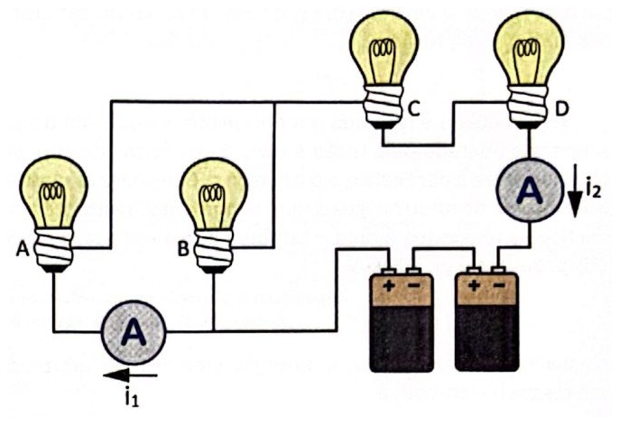

As correntes medidas nos amperímetros serão iguais e não nulas quando a(s)

**A)** lâmpadas A, B, C e D estiverem ligadas.

**B)** lâmpada A estiver queimada.

**C)** lâmpada B estiver queimada.

**D)** lâmpada C estiver queimada.

**E)** lâmpada D estiver queimada.

## Questão 100

Ao longo do tempo evolutivo, surgiram características que permitiram que os répteis se tornassem o primeiro grupo de animais vertebrados tipicamente terrestres. Uma delas é a pele grossa e rica em queratina.

Evolutivamente, essa adaptação do grupo contribuiu para a

**A)** melhoria da eficiência locomotora.

**B)** manutenção da temperatura corporal.

**C)** diminuição do risco de ressecamento.

**D)** ampliação de trocas gasosas pela pele.

**E)** excreção de compostos menos tóxicos.

## Questão 101

**A química dos povos indígenas da América do Sul**

A mandioca, alimento que se destaca na culinária brasileira, possui em seus tubos leitosos o glicosídeo de ácido cianídrico, chamado linamarina. A variedade mandioca-brava é venenosa, pois contém doses de ácido cianídrico acima de 100 mg por quilograma de polpa. A ingestão de 200 g a 500 g desse tubérculo fresco já seria letal. No entanto, esse é um dos principais alimentos de grupos indígenas da América do Sul. Para um consumo seguro, eles realizam a fervura da mandioca com água.

> SOENTGEN, Jens; HILBERT, Klaus. A química dos povos indígenas da América do Sul. **Química Nova**, n. 9, 2016 (adaptado).

Os esquemas reacionais envolvidos nesse processo estão representados a seguir.

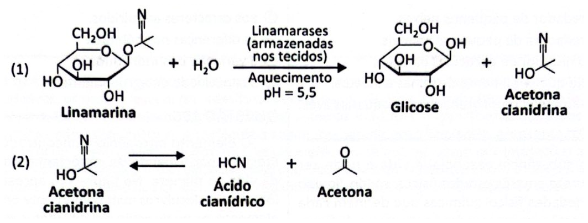

> NDUBUISI, Njoku D.; CHIDIEBERE, Ano C. U. Cyanide in Cassava: A Review. **International Journal of Genomics and Data Mining**, n. 118, 2018 (adaptado).

Esse processo, como um todo, garante o consumo seguro porque

**A)** a linamarina é transformada em compostos pouco tóxicos para os seres vivos.

**B)** o ácido cianídrico produzido na reação de hidrólise reduz a atividade da enzima.

**C)** o ácido cianídrico obtido durante as etapas do tratamento é volátil e solúvel em água.

**D)** a linamarina é um composto que interage com a água e é evaporada juntamente com ela.

**E)** a linamarina é hidrolisada com o aquecimento que atua como catalisador na reação química.

## Questão 102

O intemperismo é um fenômeno que também ocorre com o petróleo, modificando suas características, quando ele é misturado com a água do mar. Os diversos processos que acontecem durante o fenômeno estão ilustrados na figura. O estudo do intemperismo é fundamental para entender o comportamento das manchas que aparecem no mar quando ocorre vazamento de petróleo e para minimizar danos ao meio ambiente.

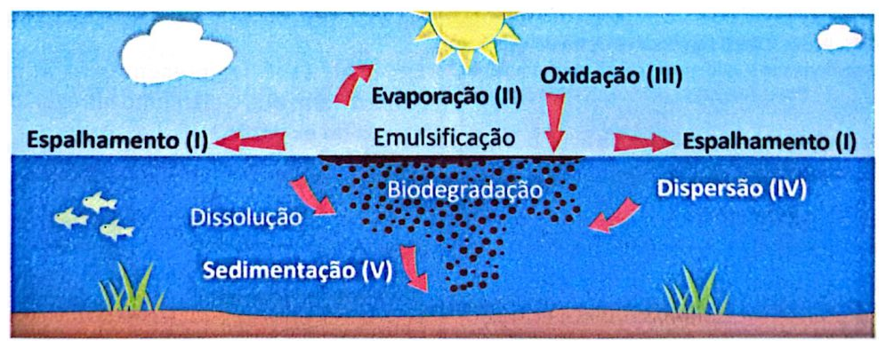

> Disponível em: www.marinha.mil.br. Acesso em: 1 dez. 2019 (adaptado).

Dentre os processos ilustrados, aquele que corresponde a uma transformação química é o

**A)** I.

**B)** II.

**C)** III.

**D)** IV.

**E)** V.

## Questão 103

Regiões de manguezal estão sujeitas ao acúmulo de poluentes, como metais pesados, resultantes de atividades industriais. Essas áreas são fonte de recursos pesqueiros, sendo a avaliação da qualidade ambiental importante para a manutenção da saúde dos consumidores e da renda das famílias de pescadores.

Para realizar a avaliação citada, um pesquisador deve optar pelo uso do seguinte organismo como indicador ambiental:

**A)** Robalo, peixe predador de pequenos peixes.

**B)** Viuvinha, ave predadora de pequenos animais.

**C)** Sururu, molusco filtrador de partículas da água.

**D)** Aratu, caranguejo que se alimenta de folhas e insetos.

**E)** Jacaré-do-papo-amarelo, réptil predador de pequenas aves.

## Questão 104

A água é uma substância essencial à vida e pode ser encontrada na natureza em três estados físicos: sólido, líquido e gasoso. As propriedades físico-químicas que definem cada um desses estados estão representadas no diagrama de fases, em que as curvas em vermelho representam o estado de equilíbrio entre duas fases. Por meio dele, é possível determinar qual é o estado físico de uma substância em um dado valor de pressão (p) e de temperatura (T).

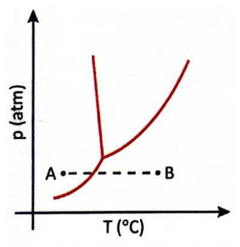

> ATKINS, Peter; JONES, Loretta. **Princípios de química:** questionando a vida moderna e o meio ambiente. Porto Alegre: Bookman, 2006 (adaptado).

Qual é a mudança de estado físico que ocorre com a água quando, à pressão constante, a temperatura varia de A para B ao longo do trajeto tracejado?

**A)** Fusão, a água muda do estado sólido para o líquido.

**B)** Ebulição, a água muda do estado líquido para o gasoso.

**C)** Sublimação, a água muda do estado sólido para o gasoso.

**D)** Solidificação, a água muda do estado líquido para o sólido.

**E)** Condensação, a água muda do estado gasoso para o líquido.

## Questão 105

“Como um júri, a seleção natural atua nas possibilidades trazidas à sua presença.”

> KARDONG, Kenneth V. **Vertebrados:** anatomia comparada, função e evolução. São Paulo: Roca, 2010.

O trecho “possibilidades trazidas à sua presença”, na citação, refere-se

**A)** ao fluxo gênico.

**B)** aos caracteres adquiridos.

**C)** às diferenças nos hábitats.

**D)** à variação dos indivíduos.

**E)** à capacidade de agrupamento.

## Questão 106

O elemento nitrogênio é encontrado na atmosfera e na litosfera, participando de importantes ciclos biogeoquímicos da vida no planeta. Na figura são apresentadas as espécies iônicas e moleculares mais comumente encontradas para esse elemento, as quais estão em diferentes estados de oxidação.

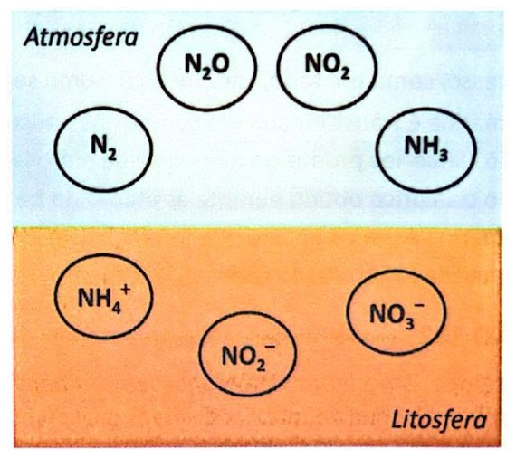

> MARTINS, Claudia R. et al. Ciclos globais de carbono, nitrogênio e enxofre: a importância na química atmosférica. **Química Nova na Escola**, n. 5, nov. 2003 (adaptado).

Em quais espécies presentes na atmosfera e na litosfera, respectivamente, o elemento nitrogênio encontra-se no menor estado de oxidação?

**A)** $\text{NH}_3$ e $\text{NH}_4^{+}$

**B)** $\text{NO}_2$ e $\text{NO}_2^{-}$

**C)** $\text{N}_2\text{O}$ e $\text{NO}_3^{-}$

**D)** $\text{NH}_3$ e $\text{NO}_3^{-}$

**E)** $\text{NO}_2$ e $\text{NH}_4^{+}$

## Questão 107

Durante uma aula de química, o professor discorre sobre propriedades intensivas e cita como exemplo a concentração. Ele afirma que, para a água pura a 20 °C, a concentração, em mol/L, é a mesma em 25,0 mL e em 500,0 mL. Nessa condição, a densidade da água é igual a 1,0 g/mL, e as massas molares, em g/mol, do hidrogênio e do oxigênio são, respectivamente, iguais a 1 e 16.

A concentração de água, em mol/L, em qualquer um desses exemplos, é mais próxima de

**A)** 0,055 mol/L.

**B)** 1,4 mol/L.

**C)** 18 mol/L.

**D)** 28 mol/L.

**E)** 56 mol/L.

## Questão 108

A nanotecnologia vem possibilitando o desenvolvimento de materiais sintéticos que imitam modelos naturais para o crescimento de ossos. Nos sistemas vivos, os ossos crescem por adesão de células especializadas a grupos funcionais ao longo de um material natural fibroso, o colágeno. Tanto nos sistemas vivos quanto nos sistemas sintéticos, o crescimento dos ossos depende da forma como as espécies químicas interagem entre si. A molécula a seguir, preparada em laboratório, apresenta três regiões (I, II e III) com propriedades estruturais diferenciadas. Inicialmente, essas moléculas se autoagrupam por interações apolares, formando um agregado tubular. Em outra região da molécula, existem grupos funcionais que interagem com o cálcio e as células, imitando o que ocorre com as fibras do colágeno nos processos de crescimento dos ossos e de cristalização do cálcio.

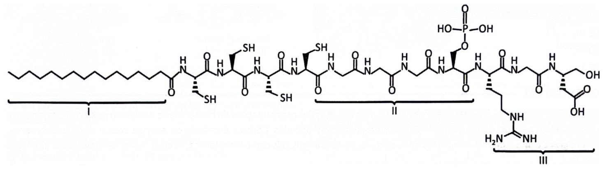

> SOLOMONS, T.W. Graham; FRYHLE, Craig B. **Química orgânica**. Rio de Janeiro: LTC, 2009 (adaptado).

Considerando as regiões I, II e III dessa molécula sintética, o início do processo do crescimento de ossos envolve o estabelecimento de

**A)** dipolo instantâneo-dipolo induzido entre os grupos funcionais da região II.

**B)** interações íon-dipolo entre grupos funcionais da região III e grupos da região II.

**C)** interações de van der Waals por meio da parte alquílica hidrofóbica da região I.

**D)** ligações covalentes entre as moléculas por meio de grupos funcionais da região III.

**E)** ligações de hidrogênio entre os grupos funcionais da região II e a parte alquílica da região I.

## Questão 109

**Etanol: crise e oportunidades**

No cenário de crises mundiais, o etanol brasileiro se destaca principalmente por ser uma alternativa aos combustíveis fósseis no processo de descarbonização. Ele pode ser considerado um protagonista e uma resposta nacional e renovável à crescente demanda mundial por diversificação de combustíveis.

> Disponível em: www.etanoleficiente.org.br. Acesso em: 9 abr. 2026 (adaptado).

Do ponto de vista ambiental, qual aspecto pode ser considerado vantajoso na produção do referido combustível?

**A)** A plantação de cana-de-açúcar retira poucos nutrientes do solo, pois essa planta tem curto ciclo de desenvolvimento.

**B)** A cana-de-açúcar, quando queimada, promove o aumento na fertilidade do solo, pois favorece a diversidade microbiana.

**C)** O ciclo de produção do etanol favorece a redução da poluição atmosférica, pois não há geração de gases com potencial efeito estufa.

**D)** A cana-de-açúcar pode ser plantada em grandes extensões de terra sem prejuízo para a fauna e a flora, pois é uma planta endêmica no país.

**E)** As emissões decorrentes da combustão do etanol são utilizadas no desenvolvimento da cana-de-açúcar, pois são incorporadas ao ciclo do carbono.

## Questão 110

A produção do biodiesel, por meio da modificação química de óleos vegetais, leva à formação de uma mistura de compostos químicos que, junto com o reagente excedente, estão presentes no produto bruto. Entre os métodos mais comuns de purificação do biodiesel, destaca-se a lavagem do produto bruto com água. Geralmente esse processo é realizado de três a quatro vezes, por causa da diferença de solubilidade dos vários componentes no solvente. Alguns constituintes dessa mistura estão representados na figura.

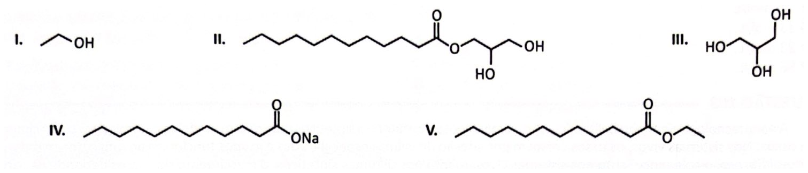

> Disponível em: www.ccbioenergia.ufv.br. Acesso em: 25 maio 2026 (adaptado).

O composto remanescente desse processo de lavagem é o

**A)** I.

**B)** II.

**C)** III.

**D)** IV.

**E)** V.

## Questão 111

A busca por fontes alternativas de energia é uma das grandes preocupações da humanidade devido ao possível esgotamento dos combustíveis fósseis e à degradação ambiental causada por eles. Como a demanda de energia cresce significativamente, há um grande investimento em outros tipos de geração de energia, tais como hidrelétrica, nuclear, solar, termelétrica a biomassa e eólica.

> BIZERRA, Ayla M. C.; QUEIROZ, Jorge L. A.; COUTINHO, Demétrios A. M. O impacto ambiental dos combustíveis fósseis e dos biocombustíveis: as concepções de estudantes do ensino médio sobre o tema. **Revbea**, n. 3, 2018 (adaptado).

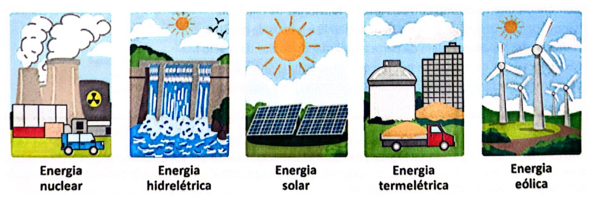

Dentre as fontes de energia citadas, o tipo de energia oriunda de uma fonte não renovável, que independe das condições climáticas para ser obtida, é a

**A)** nuclear, gerada pela fissão nuclear do urânio.

**B)** hidrelétrica, gerada pela movimentação da água.

**C)** solar, gerada pelo uso de células fotovoltaicas.

**D)** termelétrica, produzida pela combustão de biomassa.

**E)** eólica, produzida pelo movimento das pás de aerogeradores.

## Questão 112

A figura apresenta os efeitos da técnica de transgenia, em uma população de lagartas, para a introdução no milho do gene *Bt*, transferido do *Bacillus thuringiensis*.

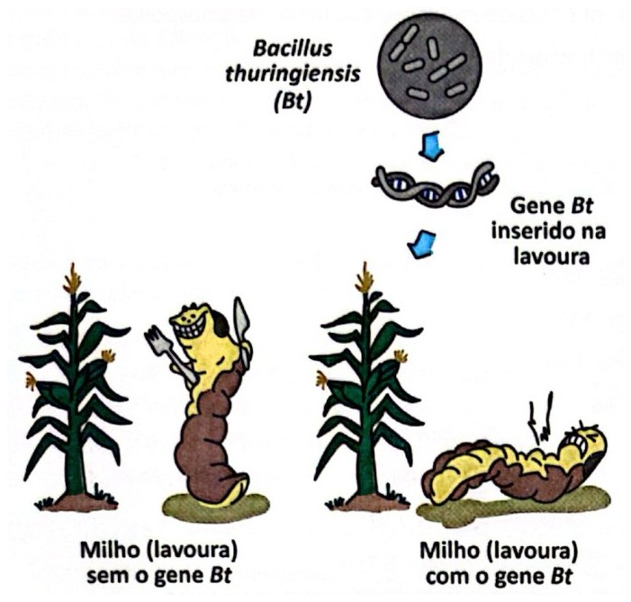

> Disponível em: https://agro.genica.com.br. Acesso em: 3 jun. 2026 (adaptado).

Para a população humana, a vantagem da aplicação da técnica ilustrada é

**A)** diminuir o custo do replantio do milho.

**B)** aumentar a produtividade da lavoura de milho.

**C)** diminuir a quantidade de lagartas transgênicas.

**D)** aumentar a necessidade do uso de praguicidas.

**E)** diminuir o uso de fertilizantes na cultura de milho.

## Questão 113

O comprimento da parte oscilante da corda de um violão determina a nota musical emitida. No braço do violão, são colocadas peças metálicas espaçadas chamadas trastes. Quando as cordas são pressionadas entre os trastes, os comprimentos de suas partes oscilantes são reduzidos, gerando ondas de diferentes frequências. Algumas notas com os valores aproximados de suas frequências são apresentadas no quadro. A figura ilustra um violão com cordas de comprimento total vibrante ($L_T$) igual a 60 cm. Considere o modo de vibração fundamental ($n = 1$) e que as frequências de vibração são inversamente proporcionais ao comprimento da parte oscilante da corda. Sabe-se que a primeira corda oscila com frequência de 660 Hz (a nota mi) quando não pressionada (corda livre).

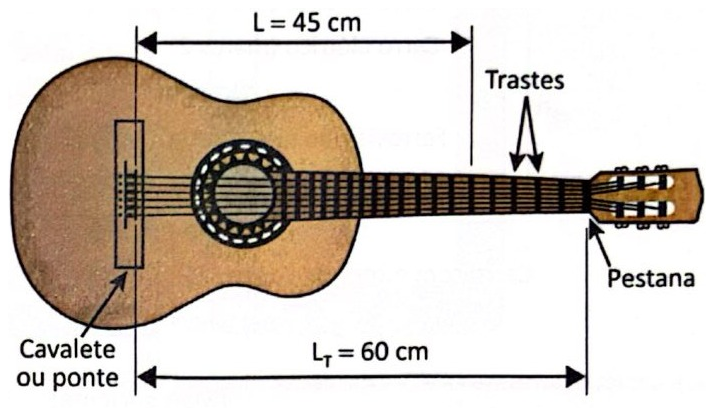

**Frequência das notas musicais, em hertz, no sistema temperado**

| Oitava | Dó | Ré | Mi | Fá | Sol | Lá | Si |
|:-:|:-:|:-:|:-:|:-:|:-:|:-:|:-:|
| 3ª | 130 | 147 | 165 | 175 | 196 | 220 | 248 |
| 4ª | 260 | 294 | 330 | 349 | 392 | 440 | 495 |
| 5ª | 520 | 587 | 660 | 698 | 784 | 880 | 990 |
| 6ª | 1 040 | 1 174 | 1 320 | 1 397 | 1 568 | 1 760 | 1 980 |

> OLIVEIRA, Leonardo M.; VEIT, Eliane A.; SCHNEIDER, Claúdio. **Oitavas e notas**. Disponível em: www.if.ufrgs.br. Acesso em: 6 nov. 2023 (adaptado).

Ao pressionar a primeira corda, de forma que a sua parte oscilante tenha 45 centímetros, e fazê-la vibrar, qual é a nota emitida pela corda?

**A)** Dó.

**B)** Mi.

**C)** Sol.

**D)** Lá.

**E)** Si.

## Questão 114

Uma fabricante de automóveis anunciou o plano de eletrificar toda a sua frota até o ano 2030. Determinado protótipo é parte fundamental dessa estratégia por ter autonomia de 1 000 km e um gasto energético de 1 kWh para cada 10 km, quando ocupado por quatro pessoas. O gráfico apresenta, para vários meios de transporte, o gasto energético por passageiro, considerado como um dos fatores determinantes para o desenvolvimento de políticas públicas de regulação dos meios de transporte.

> Disponível em: https://quatrorodas.abril.com.br. Acesso em: 2 dez. 2021 (adaptado).

De acordo com o gráfico, quantos meios de transporte apresentam maior eficiência energética que esse protótipo?

**A)** 1

**B)** 2

**C)** 4

**D)** 5

**E)** 7

## Questão 115

As cores das flores podem variar em função de características genéticas que determinam os pigmentos de suas pétalas. Na via metabólica hipotética, representada no esquema, o gene A é epistático sobre o gene B e, quando em homozigose recessiva, impede a produção de pigmentos. O gene B, em homozigose recessiva, impossibilita a formação do pigmento vermelho.

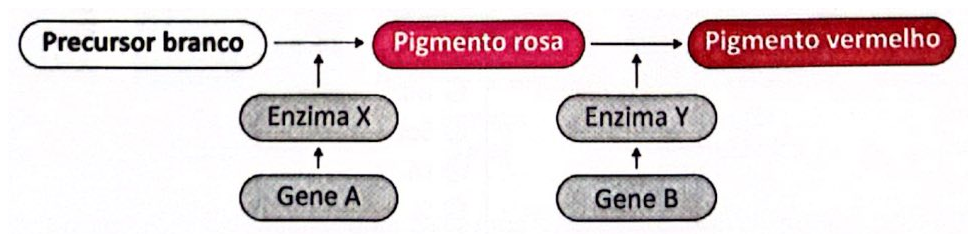

Um dos possíveis genótipos de uma planta rosa é

**A)** AaBb.

**B)** aabb.

**C)** AABB.

**D)** Aabb.

**E)** aaBb.

## Questão 116

Em documentos do século XVII, já era possível observar a preocupação com a devastação do meio ambiente em regiões do Reino Unido próximas de onde se fazia a extração do carvão. Entre as ações que alteram o ambiente, podemos destacar o processo de extração, refino e utilização de combustíveis fósseis, descarte incorreto de resíduos industriais e residenciais, emprego de compostos contendo enxofre, uso de pesticidas e técnicas rudimentares na agricultura, entre outros.

> JARDIM, Wilson F. Introdução à Química Ambiental. **Cadernos Temáticos de Química Nova na Escola**, edição especial, maio 2001 (adaptado).

Dentre as atividades citadas no texto, a que resulta na contaminação do lençol freático é o(a)

**A)** utilização de combustíveis fósseis.

**B)** liberação de derivados de enxofre na atmosfera.

**C)** descarte inadequado de pilhas e baterias usadas.

**D)** extração e derramamento do petróleo em alto-mar.

**E)** utilização de práticas agrícolas com base em queimadas.

## Questão 117

Para recuperar o cromo nos resíduos de um laboratório, realizou-se a reação de 5,2 g de $\text{Cr}^{3+}$ do efluente com hidróxido de sódio, obtendo hidróxido de cromo(III) como precipitado, o qual foi separado e calcinado até óxido de cromo(III). O processo teve rendimento de 90%. As equações químicas relativas ao processo são apresentadas a seguir:

$$\text{Cr}^{3+}\,(\text{aq}) + 3\,\text{NaOH}\,(\text{aq}) \longrightarrow \text{Cr(OH)}_3\,(\text{s}) + 3\,\text{Na}^{+}\,(\text{aq})$$

$$2\,\text{Cr(OH)}_3\,(\text{s}) \longrightarrow \text{Cr}_2\text{O}_3\,(\text{s}) + 3\,\text{H}_2\text{O}\,(\text{g})$$

Dados: massas molares ($\text{g}\cdot\text{mol}^{-1}$): Cr = 52; O = 16.

A massa, em grama, do composto $\text{Cr}_2\text{O}_3$ obtida nessa reação é mais próxima de

**A)** 3,2 g.

**B)** 6,8 g.

**C)** 7,6 g.

**D)** 8,4 g.

**E)** 13,7 g.

## Questão 118

A figura ilustra uma forma de medir a densidade relativa de dois líquidos, A e B, imiscíveis, colocando-os em um tubo em forma de U. Atingido o equilíbrio hidrostático, medem-se as alturas, $h_{A1}$ e $h_{B1}$, das colunas dos líquidos, a partir de sua superfície até o nível da linha de separação entre eles. Considere que um volume adicional de líquido A é colocado na coluna esquerda do tubo, conforme a figura. Após o equilíbrio ser restabelecido, medem-se as novas alturas, $h_{A2}$ e $h_{B2}$, da mesma maneira, comparando-as com as alturas anteriores.

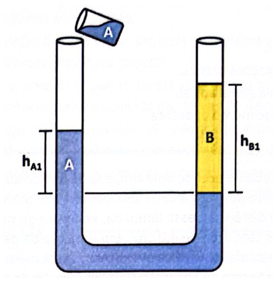

A comparação entre as novas alturas e as anteriores revela que

**A)** $h_{A2} = h_{A1}$ e $h_{B2} = h_{B1}$.

**B)** $h_{A2} > h_{A1}$ e $h_{B2} = h_{B1}$.

**C)** $h_{A2} > h_{A1}$ e $h_{B2} > h_{B1}$.

**D)** $h_{A2} < h_{A1}$ e $h_{B2} > h_{B1}$.

**E)** $h_{A2} = h_{A1}$ e $h_{B2} > h_{B1}$.

## Questão 119

O algodão é uma fibra celulósica de origem vegetal tradicionalmente utilizado na indústria têxtil. Alternativamente, por processo biotecnológico, pode-se utilizar a bactéria *Gluconacetobacter xylinus* para produzir celulose, ligando unidades de glicose em cadeia. Esse processo de obtenção de celulose de origem bacteriana apresenta algumas desvantagens relacionadas às condições laboratoriais, tais como temperatura, nutrientes e energia, além do custo ainda elevado para produção em escala industrial.

> TORTORA, Gerard J.; FUNKE, Berdell R.; CASE, Christine L. **Microbiologia**. Rio de Janeiro: Artmed, 2016 (adaptado).

Esse processo biotecnológico difere da produção de algodão tradicional porque

**A)** envolve o sequestro de carbono da atmosfera.

**B)** acelera a liberação de $\text{O}_2$ pela fotólise da água.

**C)** forma polissacarídeos por reação de hidratação.

**D)** utiliza carboidratos como fonte primária de carbono.

**E)** realiza reações catabólicas de síntese de macromoléculas.

## Questão 120

Um agricultor, interessado em iniciar um cultivo orgânico, decidiu avaliar o efeito da ação das lagartas sobre plantas jovens de feijão. O experimento consistiu em plantio de sementes de feijão em canteiro com solo fértil e úmido. As sementes germinaram após alguns dias e originaram plantas saudáveis. Quando essas plantas estavam com quatro pares de folhas definitivas, o agricultor adicionou lagartas que predaram apenas a gema apical dessas plantas.

Após sete dias, as plantas estavam

**A)** mortas.

**B)** murchas.

**C)** com brotações laterais.

**D)** com nova gema apical.

**E)** sem crescimento aparente.

## Questão 121

Um estudante acende uma lâmpada de 6 W de luz vermelha (comprimento de onda igual a 650 nm) em um quarto escuro. A 1,0 m de distância dessa lâmpada, encontra-se uma planta cujas folhas têm área de $4{,}0\ \text{cm}^2$. Em uma rápida pesquisa na internet, o estudante verifica que plantas dessa mesma espécie possuem espectro de absorção conforme ilustrado no gráfico, que apresenta a porcentagem de luz incidente absorvida em função do comprimento de onda.

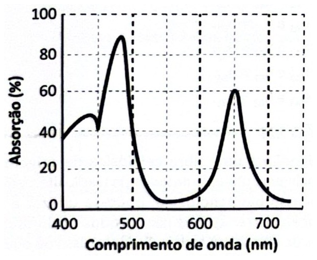

Considere a lâmpada como uma fonte puntiforme cuja intensidade luminosa é dada pela razão entre a sua potência e a área da superfície esférica formada a uma distância *r* da fonte.

Utilize 3 como valor aproximado para π.

Com base nessas informações e no gráfico, qual é o valor mais próximo da energia, em joule, que cada folha absorverá a cada segundo?

**A)** $3{,}8 \times 10^{-4}$ J

**B)** $4{,}8 \times 10^{-4}$ J

**C)** $2{,}0 \times 10^{-4}$ J

**D)** $1{,}8 \times 10^{-4}$ J

**E)** $1{,}2 \times 10^{-4}$ J

## Questão 122

A produção de um clone, por clonagem reprodutiva animal, envolveu três ovelhas e seguiu três etapas:

1. retirada do núcleo do gameta da ovelha A;
2. transferência do núcleo diploide de uma célula somática da ovelha B para o gameta anucleado da ovelha A;
3. implantação do “zigoto” formado no útero da ovelha C.

Caso esse clone apresentasse uma característica indesejada, resultante da homozigose de alelos recessivos, esses alelos seriam oriundos do(s) organismo(s)

**A)** A.

**B)** B.

**C)** C.

**D)** A e C.

**E)** A ou B.

## Questão 123

A qualidade do leite, controlada pelos institutos de saúde pública, é realizada por meio de testes específicos, para determinar densidade, teor de gordura, rancidez, acidez, presença de aditivos usados para conservação e materiais estranhos ao leite, por exemplo, adulterantes. Para mascarar a adição indevida de água ao leite, o adulterante mais utilizado é o amido.

> BOSSOLANI, Monique; LISBÔA, Julio C. F. Tipos de leite, substâncias estranhas e obtenção de plástico. **Química Nova na Escola**, n. 6, nov. 1997 (adaptado).

A adição desse adulterante tem como objetivo mascarar qual teste de controle?

**A)** Densidade, uma vez que o amido atua como soluto.

**B)** Teor de gordura, uma vez que o amido é um lipídeo.

**C)** Acidez, uma vez que o amido tem propriedade básica.

**D)** Rancidez, uma vez que o amido tem ação antimicrobiana.

**E)** Presença de conservantes, uma vez que o amido é antioxidante.

## Questão 124

**Estratégia de conservação recupera estoque natural de peixes na região do Médio Solimões**

O pirarucu (*Arapaima gigas*) é um dos maiores peixes de água doce do mundo e um importante recurso pesqueiro para comunidades ribeirinhas. Ele está na lista da convenção internacional de espécies com risco de extinção. Mas, na região do Médio Solimões, desde que o Instituto Mamirauá presta assistência à pesca, a população de pirarucu aumentou 620%. A captura do pirarucu é realizada da segunda quinzena de outubro até 30 de novembro, data limite para a autorização da pesca. Isso porque o período de dezembro a maio compreende o defeso para a reprodução dos peixes. Na região, o tamanho médio desses animais inclusive aumentou, com a média passando de 1,27 m em 1998 para 1,80 m em 2022.

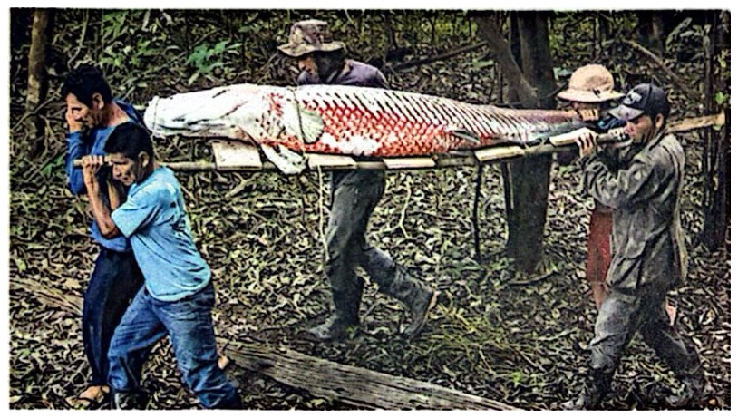

> Disponível em: www.gov.br/mcti. Acesso em: 23 abr. 2024 (adaptado).

Qual estratégia de conservação está sendo utilizada nessa região?

**A)** Extrativismo sustentável.

**B)** Criação de novos ambientes.

**C)** Seleção artificial de indivíduos.

**D)** Eliminação de predadores naturais.

**E)** Programa de reprodução em cativeiro.

## Questão 125

Atualmente, muito se discute a respeito da necessidade crescente de produção de energia elétrica. As usinas hidrelétricas são consideradas fontes de energia limpa, sustentável e renovável. Entretanto, toda intervenção humana no ambiente gera impactos. O alagamento de grandes áreas devido à construção de usinas, entre outras consequências, pode interferir no equilíbrio da flora e da fauna locais. No caso de espécies endêmicas, o impacto pode ser ainda maior, levando até mesmo à sua extinção.

Nesse contexto, para o manejo após o impacto, é importante que estudos prévios sejam feitos com o objetivo de

**A)** avaliar a potabilidade da água.

**B)** monitorar a biodiversidade local.

**C)** estimular a introdução de espécies exóticas.

**D)** promover a variedade de espécies lacustres.

**E)** favorecer a emigração das espécies silvestres.

## Questão 126

Em 2012, durante várias campanhas de combate à dengue, uma das ações de prevenção foi a eliminação de espécimes de plantas epífitas conhecidas como bromélias, por facilitarem o acúmulo de água parada em suas folhas sobrepostas.

> Disponível em: www.ensp.fiocruz.br. Acesso em: 28 fev. 2012 (adaptado).

A eliminação dessas plantas foi justificada para o combate à dengue porque

**A)** os mosquitos adultos das espécies vetoras se abrigam entre as suas folhas sobrepostas.

**B)** a disposição de suas folhas propicia o ambiente ideal para o acasalamento do *Aedes aegypti*.

**C)** o tipo de ambiente que se forma com a água acumulada é favorável ao desenvolvimento das larvas do *Aedes aegypti*.

**D)** os mosquitos transmissores da doença se alimentam dos nutrientes solubilizados na água acumulada em suas folhas.

**E)** a água acumulada é o ambiente propício para que o vírus da dengue se espalhe entre os mosquitos transmissores da doença.

## Questão 127

A figura representa uma resposta imune secundária à presença de determinadas bactérias.

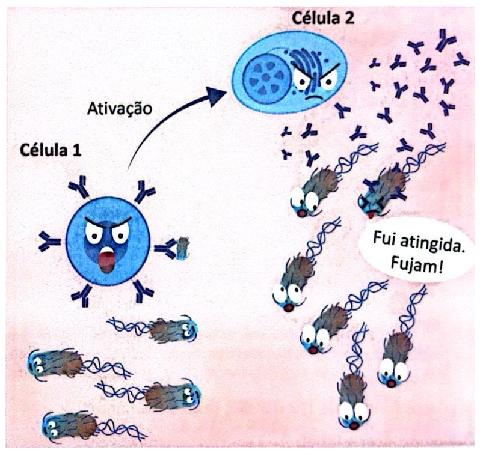

> Disponível em: https://cienciaviva.org.br. Acesso em: 6 jul. 2026 (adaptado).

A célula 2 do sistema imunológico representada na figura é um

**A)** basófilo, porque libera heparina e histamina.

**B)** linfócito T auxiliar, porque reconhece o invasor.

**C)** macrófago, porque fagocita as bactérias invasoras.

**D)** linfócito T citotóxico, porque destrói a célula infectada.

**E)** plasmócito, porque produz anticorpos contra as bactérias.

## Questão 128

Ao trafegar à noite, é necessário manter os faróis dos veículos acesos. Quando a umidade relativa do ar é baixa, o motorista consegue ter boa visibilidade da pista. No entanto, em noites em que há neblina, essa visibilidade é reduzida.

Nessa situação, a visibilidade reduzida deve-se à

**A)** dispersão da luz pelas gotículas de água suspensas no ar.

**B)** polarização da luz pelas gotículas de água dispersas no ar.

**C)** condensação das gotículas de água na superfície do farol.

**D)** solubilização das gotículas de água presentes no ar.

**E)** redução da potência da luz emitida pelo farol.

## Questão 129

A vanilina, $\text{C}_8\text{H}_8\text{O}_3$, é um composto orgânico responsável pelo odor característico do extrato da semente de baunilha, aromatizante largamente utilizado em alimentos, bebidas, perfumes e fármacos. Sua estrutura química está representada por esferas com cores distintas para destacar os diferentes átomos.

> PACHECO, Sabrina M. V.; DAMASIO, Felipe. Vanilina: origem, propriedades e produção. **Química Nova na Escola**, n. 4, nov. 2010 (adaptado).

Os grupos funcionais 1, 2 e 3 são, respectivamente,

**A)** aldeído, éter e fenol.

**B)** cetona, éster e enol.

**C)** cetona, éster e fenol.

**D)** aldeído, éter e álcool.

**E)** cetona, amina e álcool.

## Questão 130

Um jardineiro está irrigando as plantas de um jardim com uma mangueira. Ele estica completamente a mangueira para se aproximar de algumas flores mais afastadas, sem, no entanto, alcançá-las. Daí, ocorre-lhe que obstruir a extremidade da mangueira com o polegar faz com que o jato de água atinja uma distância maior, comparativamente com a situação sem essa ação, permitindo-lhe molhar aquelas flores mais afastadas.

Essa alteração no alcance do jato de água deve-se ao aumento do(a)

**A)** velocidade da água lançada.

**B)** densidade da água lançada.

**C)** volume da água lançada.

**D)** massa da água lançada.

**E)** vazão da água lançada.

## Questão 131

Uma célula a combustível fornece energia elétrica por meio de uma reação química, conforme representação a seguir.

> GONICK, Lawrence; CRIDDLE, Craig. **The Cartoon Guide to Chemistry**. New York: Collins Reference, 2005 (adaptado).

A equação química global desse processo é:

**A)** $\text{H}_2\text{O} \longrightarrow \text{H}^+ + \text{OH}^-$

**B)** $\text{H}_2 + 2\ \text{O}_2 \longrightarrow 2\ \text{H}^+ + 4\ \text{O}^{2-}$

**C)** $2\ \text{H}_2\text{O} \longrightarrow \text{O}_2 + 2\ \text{H}^+ + \text{H}_2 + 2\ \text{e}^-$

**D)** $6\ \text{H}^+ + \text{O}_2 \longrightarrow 2\ \text{H}_2\text{O} + \text{H}_2$

**E)** $2\ \text{H}_2 + \text{O}_2 \longrightarrow 2\ \text{H}_2\text{O}$

## Questão 132

Um casal tentou ter filhos naturalmente por muito tempo. Sem sucesso, resolveram procurar uma clínica de reprodução e fazer uso de técnicas de fertilização in vitro. Em um primeiro procedimento, conseguiram produzir um único embrião. O médico sugeriu o congelamento desse embrião e a repetição do processo, que originou um segundo embrião. Esses dois embriões foram então implantados no útero em um único procedimento e, para felicidade do casal, seguiu-se uma gestação gemelar com sucesso.

Nessa situação, os gêmeos são

**A)** dizigóticos, obrigatoriamente do mesmo sexo.

**B)** monozigóticos, obrigatoriamente do mesmo sexo.

**C)** dizigóticos, obrigatoriamente de sexos diferentes.

**D)** dizigóticos, do mesmo sexo ou de sexos diferentes.

**E)** monozigóticos, do mesmo sexo ou de sexos diferentes.

## Questão 133

O quadro foi retirado de um manual que apresenta as especificações e a potência de um aparelho de TV.

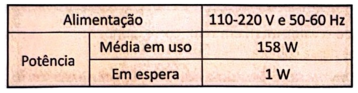

Se uma pessoa assistiu à TV durante 4 horas e no restante do dia o aparelho permaneceu em espera, qual é a porcentagem da energia utilizada em espera quando comparada com o total de energia utilizado?

**A)** 0,2%

**B)** 0,6%

**C)** 1,0%

**D)** 3,0%

**E)** 20%

## Questão 134

Para sintetizar ATP, as células musculares podem utilizar a glicose, proveniente do sangue, ou o glicogênio. Em ambos os processos, é produzido piruvato, que, na respiração anaeróbica, é convertido em lactato e, na respiração aeróbica, é transportado para as mitocôndrias. Essas diferentes vias de obtenção de energia pelas células podem afetar o rendimento de atletas profissionais. Frequentemente, corredores de maratona realizam seus treinamentos em locais de maior altitude, onde o ar rarefeito condiciona o organismo a uma menor disponibilidade de oxigênio para sua atividade física. Esse condicionamento auxilia as células musculares a obterem a maior parte de sua energia durante o esforço físico pelo processo de respiração aeróbica, cujo rendimento energético é maior em relação à respiração anaeróbica.

> FURLAN, Julia P. et al. **Saúde e Pesquisa**, n. 1, jan.-abr. 2017 (adaptado).

O sucesso desse condicionamento pode ser avaliado com o monitoramento de parâmetros sanguíneos em um teste de esforço físico. Nesse caso, a análise das amostras de sangue devem indicar

**A)** aumento da taxa de glicemia.

**B)** redução no teor de proteínas.

**C)** redução nos níveis de lactato.

**D)** redução no número de hemácias.

**E)** aumento da concentração de piruvato.

## Questão 135

Um dos problemas ambientais relacionados à queima de combustíveis para obtenção de energia reside na produção de gases tóxicos, como CO, $\text{NO}_x$ e $\text{SO}_x$, e materiais particulados, como fuligem. O quadro apresenta valores de entalpia de reação da combustão de cinco fontes energéticas.

| Combustível | Equação da reação de combustão | Entalpia de reação ($\text{kJ mol}^{-1}$) |
|:---:|:---:|:---:|
| Etanol | $\text{C}_2\text{H}_6\text{O} + 3\ \text{O}_2 \longrightarrow 2\ \text{CO}_2 + 3\ \text{H}_2\text{O}$ | −1 368 |
| Metano | $\text{CH}_4 + 2\ \text{O}_2 \longrightarrow \text{CO}_2 + 2\ \text{H}_2\text{O}$ | −890 |
| Metanol | $\text{CH}_4\text{O} + \frac{3}{2}\ \text{O}_2 \longrightarrow \text{CO}_2 + 2\ \text{H}_2\text{O}$ | −726 |
| Acetileno (etino) | $\text{C}_2\text{H}_2 + \frac{5}{2}\ \text{O}_2 \longrightarrow 2\ \text{CO}_2 + \text{H}_2\text{O}$ | −1 301 |
| Carvão (antracito) | $\text{C} + \text{O}_2 \longrightarrow \text{CO}_2$ | −355 |

> ATKINS, Peter; JONES, Loretta. **Princípios de química**: questionando a vida moderna e o meio ambiente. Porto Alegre: Bookman, 2006 (adaptado).

Qual é o combustível mais eficiente em relação à quantidade de energia gerada por quantidade de matéria, em mol, de carbono?

**A)** Etanol.

**B)** Metano.

**C)** Metanol.

**D)** Acetileno (etino).

**E)** Carvão (antracito).

---

# Matemática e suas Tecnologias — Questões de 136 a 180

## Questão 136

O comprimento de escala de um violão é dado pela distância, em polegada, entre o rastilho e a pestana, conforme figura.

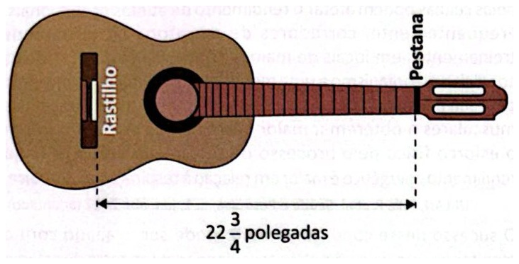

A representação decimal desse número é

**A)** 25,40.

**B)** 22,75.

**C)** 21,25.

**D)** 16,50.

**E)** 6,25.

## Questão 137

O preço de venda *V* de um produto, em real, é dado pela expressão $V = (M + F) \times (1 + L)$, em que *M* e *F* são, respectivamente, os custos dos insumos utilizados e os custos de fabricação, cuja soma representa o custo total do produto, em real, e *L* é o percentual de lucro sobre o custo total com a venda desse produto.

Durante o último ano, *M* foi 50% superior a *F*. Para o ano atual, *M* teve uma redução de 30% e *F*, um acréscimo de 45%, ambos em relação ao último ano.

Para que o preço de venda *V* permaneça inalterado, o percentual de lucro no ano atual, em relação ao do último ano, deverá

**A)** aumentar 15%.

**B)** aumentar 7,5%.

**C)** diminuir 7,5%.

**D)** diminuir 15%.

**E)** manter-se inalterado.

## Questão 138

A imagem representa o cupom fiscal fornecido por um supermercado a um cliente após a realização de sua compra.

Para cada produto, o valor relativo ao imposto é calculado aplicando-se o percentual indicado no cupom sobre o preço por ele cobrado.

Qual é o valor total, em real, correspondente aos impostos pagos nessa compra?

**A)** 2,70

**B)** 3,15

**C)** 4,50

**D)** 5,30

**E)** 5,40

## Questão 139

Uma cafeteria vende cápsulas de café nas intensidades tradicional, suave, forte e extraforte. Ela comercializa essas cápsulas em kits com 12 unidades, contendo:

- pelo menos duas cápsulas de café na intensidade tradicional e pelo menos uma cápsula de cada uma das demais intensidades;
- quantidades iguais de cápsulas de café nas intensidades suave e forte.

Quantos kits diferentes podem ser formados?

**A)** 20

**B)** 25

**C)** 36

**D)** 286

**E)** 455

## Questão 140

O conceito de grupo sanguíneo se baseia na presença ou ausência de um ou dois antígenos (A e B) na membrana dos glóbulos vermelhos. Com relação a esses dois antígenos, há quatro grupos sanguíneos.

- A: apenas o antígeno A está presente;
- B: apenas o antígeno B está presente;
- AB: ambos os antígenos estão presentes;
- O: nenhum dos antígenos está presente.

Além dos antígenos A e B, há outro antígeno envolvido, chamado fator Rh, indicado com o sinal "+" quando está presente, ou com o sinal "−" quando está ausente. Dessa forma, o grupo sanguíneo de uma pessoa é descrito usando-se letras e o sinal indicador do fator Rh, por exemplo: O⁺, A⁺, AB⁻. Há dois grupos sanguíneos que se destacam: AB⁺, denominado "receptor universal", que em uma transfusão de sangue a pessoa pode receber sangue de qualquer tipo; e O⁻, denominado "doador universal", cujo sangue pode ser recebido por qualquer pessoa.

> Disponível em: http://saude.hsw.uol.com.br. Acesso em: 2 mar. 2012 (adaptado).

Em uma cidade, foi realizado um levantamento dos grupos sanguíneos de todos os moradores, constatando-se que 25% da população apresenta apenas o antígeno tipo A; 25%, apenas o tipo B e 30%, o tipo AB. Além disso, em cada grupo sanguíneo, a ocorrência do fator Rh⁺ é de 60%.

A probabilidade de uma pessoa dessa cidade, escolhida ao acaso, ser receptora universal ou doadora universal é

**A)** 0,3.

**B)** 0,26.

**C)** 0,06.

**D)** 0,036.

**E)** 0,0144.

## Questão 141

Um usuário de telefonia móvel quer contratar um serviço de dados 5G e foi informado de que a taxa média de transferência de dados ofertada nesse serviço é 436 Mb/s. Como ele não conhecia essa unidade de medida, pesquisou e verificou que ela relaciona duas grandezas.

Qual razão entre as grandezas fornece a taxa média de transferência de dados?

**A)** $\dfrac{\text{volume de dados}}{\text{tempo}}$

**B)** $\dfrac{\text{distância}}{\text{volume de dados}}$

**C)** $\dfrac{\text{tempo}}{\text{volume de dados}}$

**D)** $\dfrac{\text{velocidade}}{\text{distância}}$

**E)** $\dfrac{\text{distância}}{\text{tempo}}$

## Questão 142

Um artesão confeccionará um pingente conectando uma pirâmide a um prisma, formando um novo poliedro. Para isso, utiliza uma pirâmide com 10 arestas, cuja base é congruente às bases do prisma. Esses dois poliedros serão colados um ao outro, de forma a coincidirem as arestas da base da pirâmide com as arestas de uma das bases do prisma.

Quantas faces terá esse pingente?

**A)** 11

**B)** 13

**C)** 19

**D)** 21

**E)** 23

## Questão 143

Um jardim, cuja vista superior é o quadrado *ABCD*, será reformado para dar lugar a um novo jardim cuja vista superior seja a de um círculo. O jardim circular deverá conter a região do jardim original e ter a menor área possível.

Para viabilizar o projeto, foi feita a representação no plano cartesiano do jardim original, em que os eixos foram orientados nas direções sul-norte e oeste-leste e graduados em metro. Os pontos que correspondem aos vértices *C* e *D* do jardim original estão com suas coordenadas explicitadas, conforme figura.

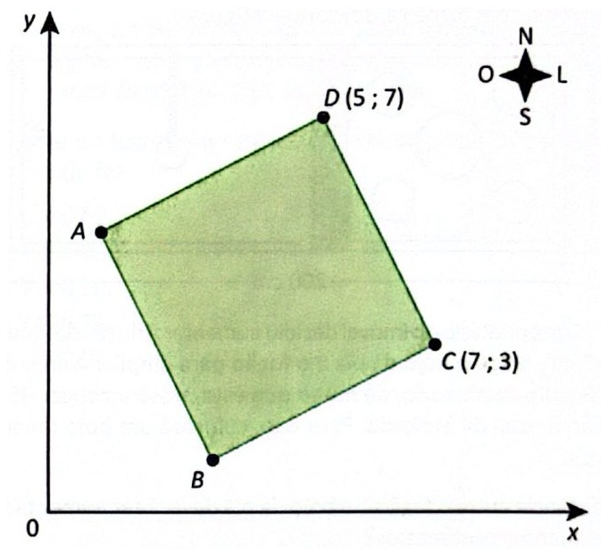

Qual é a equação da circunferência que delimitará a região do novo jardim?

**A)** $x^2 + y^2 - 10 = 0$

**B)** $x^2 + y^2 - 8x - 8y + 22 = 0$

**C)** $x^2 + y^2 - 16x - 12y + 90 = 0$

**D)** $x^2 + y^2 - 12x - 10y + 56 = 0$

**E)** $x^2 + y^2 + 8x + 8y + 32 - \sqrt{10} = 0$

## Questão 144

O dono de uma loja de importados realizou o balanço das vendas realizadas no primeiro semestre deste ano. A tabela apresenta a quantidade de tablets de um modelo vendido em cada mês desse período.

| Mês | Quantidade de tablets vendidos |
|:---:|:---:|
| Janeiro | 44 |
| Fevereiro | 56 |
| Março | 44 |
| Abril | 48 |
| Maio | 62 |
| Junho | 52 |

A mediana das quantidades mensais de tablets desse modelo vendidos no primeiro semestre é

**A)** 44.

**B)** 46.

**C)** 50.

**D)** 51.

**E)** 52.

## Questão 145

A bancada na cozinha de um imóvel tem um fogão cooktop e uma pia com torneira, conforme a figura.

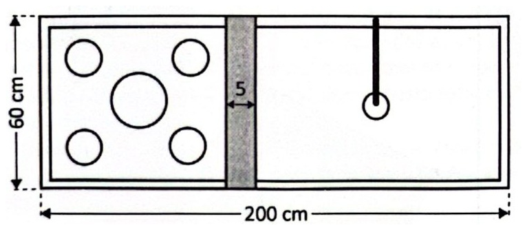

O proprietário do imóvel decidiu aumentar a distância, que é de 5 cm, entre o bojo da pia e o fogão para ampliar a área do retângulo sombreado, de modo que esta passe a ocupar 35% da área total da bancada. Para isso, colocará um bojo menor na pia.

A distância entre o fogão e o bojo da pia deverá ser aumentada em quantos centímetros?

**A)** 21

**B)** 44

**C)** 49

**D)** 65

**E)** 70

## Questão 146

O gráfico apresenta a evolução das temperaturas máxima (Tmáx) e mínima (Tmín) em uma cidade ao longo dos primeiros 15 dias de um mês.

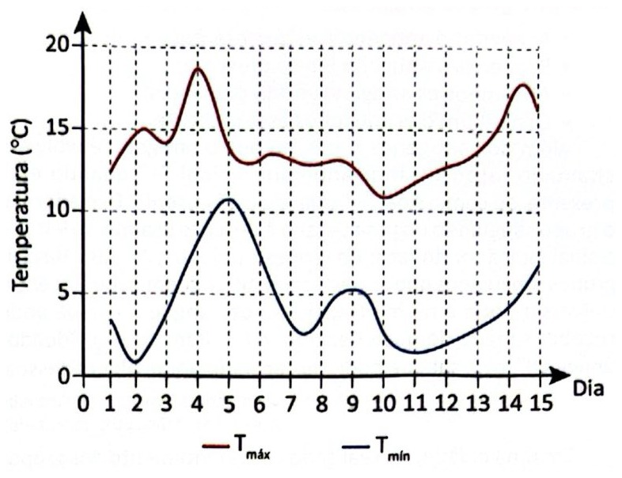

Os dias em que ocorreram a maior temperatura máxima e a menor temperatura mínima foram, respectivamente,

**A)** 10 e 5.

**B)** 10 e 2.

**C)** 5 e 15.

**D)** 4 e 5.

**E)** 4 e 2.

## Questão 147

Um adolescente, tendo em vista uma alimentação saudável, consome diariamente 7,5 dL de leite durante 1 mês (30 dias). Sabe-se que o preço de um litro de leite é R$ 1,98.

> Disponível em: www.infopedia.pt. Acesso em: 13 jun. 2012 (adaptado).

Nessas condições, o custo mensal com o consumo de leite desse adolescente é de

**A)** R$ 14,85.

**B)** R$ 22,50.

**C)** R$ 44,55.

**D)** R$ 148,50.

**E)** R$ 445,50.

## Questão 148

Em um jogo, o participante deve arremessar um disco sobre um tabuleiro. Esse tabuleiro é formado por 4 círculos de raio 10 cm, que se tangenciam, e a região de cor verde delimitada por eles, conforme figura. Os círculos estão dispostos de maneira que seus centros possam ser vértices de um quadrado.

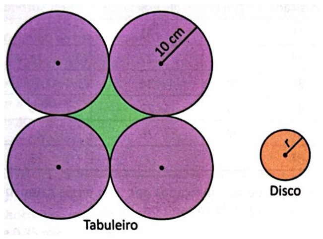

Uma jogada é considerada válida somente se o centro do disco cair sobre o tabuleiro. O participante vence apenas se o disco cair inteiramente sobre um dos círculos.

O criador desse jogo escolherá um valor inteiro para a medida *r* do raio do disco, de maneira que a probabilidade de vitória em uma jogada válida seja inferior a 60%.

Utilize 3 como aproximação para π.

A medida mínima de *r*, em centímetro, a ser escolhida é

**A)** 2.

**B)** 4.

**C)** 5.

**D)** 6.

**E)** 8.

## Questão 149

Para diminuir custos com transporte, uma pessoa venderá seu carro à combustão para comprar um carro elétrico, entre dois modelos disponíveis. As especificações de consumo de energia de cada um desses modelos são:

- carro I: consumo de 20 MJ (megajoules) para percorrer 48 km na cidade ou 32 km na estrada;
- carro II: consumo de 25 MJ (megajoules) para percorrer 50 km na cidade ou 45 km na estrada.

Ela comprará o carro que apresentar menor consumo de energia para percorrer 3 000 km, sendo 1 200 km percorridos em trechos de cidade e 1 800 km em trechos de estrada.

Ela comprará o carro

**A)** I, pois o consumo de energia será de 81,25 MJ.

**B)** I, pois o consumo de energia será de 600 MJ.

**C)** I, pois o consumo de energia será de 1 625 MJ.

**D)** II, pois o consumo de energia será de 64 MJ.

**E)** II, pois o consumo de energia será de 1 600 MJ.

## Questão 150

O deslocamento de carro entre duas cidades pode ser feito por dois trajetos, cujos comprimentos e velocidades médias nesses trajetos são:

- I: 100 km e 50 km/h;
- II: 120 km e 80 km/h.

Uma pessoa se deslocará de carro entre essas cidades e escolherá o trajeto que pode ser percorrido no menor tempo ao adotar a respectiva velocidade média.

Essa pessoa escolherá o trajeto

**A)** I, pois é o trajeto que apresenta o menor comprimento.

**B)** I, pois precisará de 30 minutos para realizar esse deslocamento.

**C)** I, pois é o trajeto que apresenta a menor soma entre comprimento e velocidade.

**D)** II, pois é o trajeto que apresenta a menor diferença entre comprimento e velocidade.

**E)** II, pois precisará de 90 minutos para realizar esse deslocamento.

## Questão 151

Uma empresa foi fundada por 3 sócios, que combinaram que iriam distribuir o lucro obtido ao final de 18 meses. Essa distribuição será feita em partes diretamente proporcionais ao investimento feito por sócio e ao tempo em que cada um deles permanecer como sócio. Passados 6 meses da criação dessa empresa, o sócio que havia investido R$ 5 000,00 saiu da sociedade. Os outros dois sócios, um que investiu R$ 4 000,00 e o outro que investiu R$ 6 000,00, permaneceram os 18 meses. Ao final desse período, o lucro total de R$ 21 000,00 foi distribuído.

A parte do lucro, em real, destinada ao sócio que saiu da sociedade foi

**A)** 1 000,00.

**B)** 2 333,33.

**C)** 3 000,00.

**D)** 3 620,70.

**E)** 7 000,00.

## Questão 152

Uma empresa que produz sinalizadores realiza um teste de segurança de seus produtos. Esse teste consiste em registrar em um plano cartesiano, com os eixos graduados em metro, a trajetória parabólica do projétil lançado pelo sinalizador, e calcular os valores de dois parâmetros, $D_1$ (distância entre o ponto de lançamento e o ponto de altura máxima, em metro) e $D_2$ (distância entre o ponto de lançamento e o ponto de explosão, em metro), conforme representado na figura.

O nível de segurança do sinalizador é classificado de 1 (nível mínimo) a 5 (nível máximo), segundo os valores apurados para $D_1$ e $D_2$, conforme os critérios apresentados na tabela.

| Nível de segurança | $D_1$ | $D_2$ |
|:---:|:---:|:---:|
| 1 | $D_1 < 23$ | $D_2 < 23$ |
| 2 | $23 \leq D_1 < 25$ | $D_2 < 23$ |
| 3 | $23 \leq D_1 < 25$ | $23 \leq D_2 < 25$ |
| 4 | $D_1 \geq 25$ | $23 \leq D_2 < 25$ |
| 5 | $D_1 \geq 25$ | $D_2 \geq 25$ |

Em um teste de segurança, a trajetória do projétil lançado por um sinalizador foi modelada pela função $y = -0{,}24x^2 + 4{,}8x$ e apurou-se que $k = 15$.

De acordo com essa classificação, o nível de segurança desse sinalizador foi

**A)** 1.

**B)** 2.

**C)** 3.

**D)** 4.

**E)** 5.

## Questão 153

O quadro apresenta a classificação final dos 6 times que disputaram um campeonato de futebol, com as informações parciais das quantidades de gols marcados e sofridos por esses times.

| Posição | Time | Gols marcados | Gols sofridos |
|:---:|:---:|:---:|:---:|
| 1ª | I | 31 | 23 |
| 2ª | II | 27 | 21 |
| 3ª | III | 34 | *y* |
| 4ª | IV | 22 | 26 |
| 5ª | V | 26 | 22 |
| 6ª | VI | *x* | 28 |

A média de gols marcados por time nesse campeonato foi 25 e a mediana de gols sofridos foi 24.

A soma $x + y$ é igual a

**A)** 32.

**B)** 34.

**C)** 35.

**D)** 42.

**E)** 47.

## Questão 154

Marcos possui recursos em uma aplicação que rende 1% ao mês a juros compostos. Quando o saldo dessa aplicação alcançar R$ 90 000,00, ele comprará um carro, cujas duas opções de pagamento são:

- R$ 89 000,00, à vista, no ato da compra;
- 3 parcelas mensais iguais, no valor de R$ 30 000,00 cada, sendo a primeira paga no ato da compra.

O pagamento por esse carro será feito utilizando somente recursos provenientes dessa aplicação, que serão resgatados nos momentos apropriados e nas quantias necessárias. Ele escolherá a opção de pagamento na qual, 2 meses após a compra do carro, o saldo de sua aplicação seja o maior.

Ao final desses 2 meses, o saldo, em real, da aplicação de Marcos será

**A)** 1 000,00.

**B)** 1 010,00.

**C)** 1 020,10.

**D)** 1 509,00.

**E)** 1 824,09.

## Questão 155

Depreciação é o processo de desvalorização de um bem patrimonial decorrente do uso ou desgaste natural ao longo do tempo. Um carro zero quilômetro é vendido por R$ 80 000,00 e, imediatamente após a venda, ao sair da concessionária, já desvaloriza 10%. A partir daí, há uma depreciação anual de 12%.

Qual expressão algébrica relaciona o valor *V* desse carro, em real, com o tempo de uso *t*, em ano?

**A)** $V = 72\,000 \cdot 0{,}88^{t}$

**B)** $V = 72\,000 \cdot 0{,}12^{t}$

**C)** $V = 80\,000 \cdot 0{,}78^{t}$

**D)** $V = 80\,000 \cdot 0{,}22^{t}$

**E)** $V = 80\,000 \cdot 0{,}12^{t}$

## Questão 156

Um estudante de biologia aprendeu que o diâmetro médio da mitocôndria, organela responsável pela respiração celular, mede 0,75 micrômetro (1 micrômetro equivale à milionésima parte de um metro).

> Disponível em: https://brasilescola.uol.com.br. Acesso em: 9 nov. 2022 (adaptado).

Para ter uma ideia do quão pequena é a mitocôndria, o estudante converteu a medida desse diâmetro para a unidade milímetro.

A medida do diâmetro médio da mitocôndria, em milímetro, é

**A)** $7{,}5 \times 10^{-1}$

**B)** $7{,}5 \times 10^{-2}$

**C)** $7{,}5 \times 10^{-4}$

**D)** $7{,}5 \times 10^{-5}$

**E)** $7{,}5 \times 10^{-7}$

## Questão 157

No momento do Big Bang, o Universo passou por um crescimento enorme que durou menos de um trilionésimo de segundo. Para se ter uma ideia desse tempo, um trilionésimo é um número que pode ser representado por uma fração em que o numerador é 1 e o denominador é um número inteiro iniciado por 1 seguido apenas de zeros.

> Disponível em: http://super.abril.com.br. Acesso em: 16 out. 2015.

Representando um trilionésimo por uma fração, quantos zeros após o 1 do denominador existem nessa fração?

**A)** 9

**B)** 11

**C)** 12

**D)** 14

**E)** 15

## Questão 158

Cinco candidatos, $C_1$, $C_2$, $C_3$, $C_4$ e $C_5$, foram selecionados para ocupar vagas para estagiários em uma empresa. Cada um deles foi entrevistado pelos diretores $D_1$, $D_2$, $D_3$, $D_4$ e $D_5$, dos cinco departamentos em que serão alocados. Nas entrevistas, os diretores atribuíram notas de 0 a 5 a cada entrevistado. As notas nessas entrevistas estão dispostas em linhas e colunas, conforme a imagem, na qual a nota posicionada na linha i e na coluna j representa a nota recebida pelo candidato $C_i$, atribuída pelo diretor $D_j$. Por exemplo, a nota 4 circulada, que está na segunda linha e na quarta coluna, corresponde à nota atribuída ao candidato $C_2$ pelo diretor $D_4$.

Ao final das entrevistas, o diretor $D_1$ escolherá como estagiário o candidato a quem atribuiu a maior nota; em seguida, o diretor $D_2$ escolherá como estagiário, dentre os restantes, aquele a quem atribuiu a maior nota; e assim sucessivamente.

O candidato a ser escolhido pelo diretor $D_5$ é o

**A)** $C_1$.

**B)** $C_2$.

**C)** $C_3$.

**D)** $C_4$.

**E)** $C_5$.

## Questão 159

Uma loja de roupas femininas vende apenas blusas e vestidos. O lucro é de R$ 10,00 em cada blusa e de R$ 30,00 em cada vestido, se estes forem comprados com dinheiro em espécie. Contudo, o lucro é 10% menor em cada peça que for comprada utilizando-se um cartão de crédito para o pagamento. Neste mês a loja conseguiu vender um total de 1 800 peças, sendo que todas as blusas e apenas um terço dos vestidos vendidos foram pagos com dinheiro.

Se *x* é a quantidade de blusas vendidas, a expressão que representa o lucro total obtido com as vendas do referido mês é

**A)** $21\,600 - 2x$

**B)** $48\,600 - 18x$

**C)** $50\,400 - 18x$

**D)** $52\,200 - 19x$

**E)** $54\,000 - 20x$

## Questão 160

Um agricultor possui um terreno plano formado por 4 canteiros, 3 em formato retangular, semelhantes entre si, e 1 em formato triangular, delimitado pelos 3 primeiros, conforme figura.

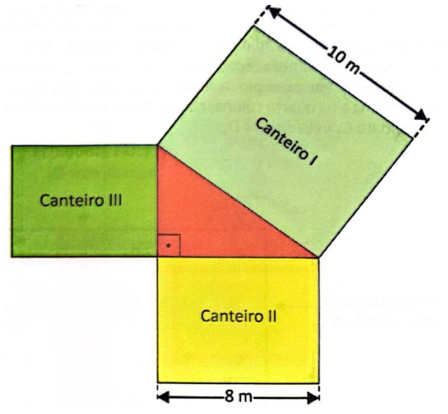

Os maiores lados dos canteiros I e II medem 10 m e 8 m, respectivamente, e a área do canteiro I mede 80 m².

Qual é a diferença entre as medidas das áreas, em metro quadrado, dos canteiros II e III?

**A)** 16,00

**B)** 17,92

**C)** 20,00

**D)** 22,40

**E)** 28,00

## Questão 161

A diretora de uma creche coletou, das cadernetas de vacinação de cinco crianças, a informação sobre o número de doses de vacinas aplicadas nos primeiros quatro semestres de vida. A seguir são apresentadas as sequências das quantidades de doses que cada criança recebeu no 1º, 2º, 3º e 4º semestres, respectivamente:

- criança I: 10, 5, 5, 5;
- criança II: 12, 3, 5, 5;
- criança III: 13, 4, 5, 4;
- criança IV: 11, 5, 5, 3;
- criança V: 13, 3, 7, 3.

A diretora fará uma reunião com os pais das crianças dessa creche com o objetivo de conscientizá-los da importância de completarem as doses de vacinas que faltam. Para ilustrar a importância desse assunto, ela escolherá os dados de uma dessas cinco cadernetas para apresentar na reunião. Serão escolhidos os dados da caderneta de vacinação que apresentar a menor média semestral das quantidades de doses de vacinas aplicadas nos primeiros quatro semestres de vida dessas crianças.

A caderneta que contém os dados a serem escolhidos pela diretora para a reunião é a da criança

**A)** I.

**B)** II.

**C)** III.

**D)** IV.

**E)** V.

## Questão 162

A Carga Tributária Bruta (CTB) é um índice utilizado por agências de pesquisas econômicas para orientar possíveis investidores. O gráfico ilustra os valores percentuais da CTB de um país em função do tempo *t*, em ano, sendo que $t = 0$ corresponde a 2021, $t = 1$ a 2022, $t = 2$ a 2023, e assim sucessivamente.

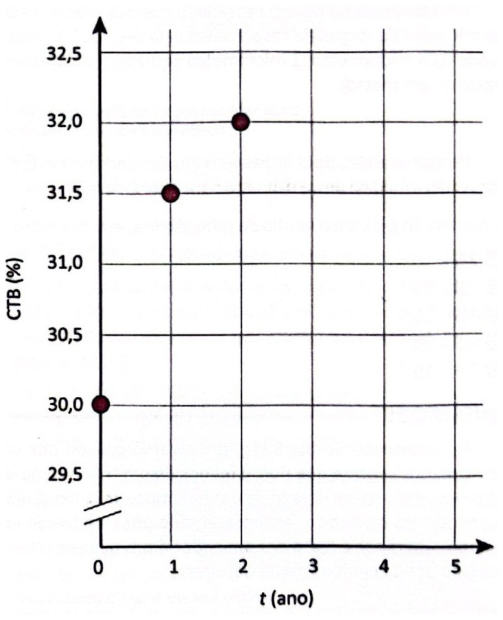

Com base nesses dados, uma agência fez uma extrapolação para estimar o valor percentual da CTB para 2026, considerando que esse índice varia segundo uma função quadrática.

O valor percentual da CTB estimado para 2026, obtido por essa agência, foi

**A)** 25,5.

**B)** 27,5.

**C)** 30,0.

**D)** 33,5.

**E)** 35,0.

## Questão 163

Uma padaria vende pizzas de calabresa e de frango. Há 3 funcionários nessa padaria: Ana, Carla e José. No sábado, Ana vendeu 6 pizzas de calabresa e 15 de frango, tendo recebido 780 reais por essas vendas; Carla vendeu 5 pizzas de calabresa e 8 de frango, pelas quais recebeu 470 reais; e José vendeu 4 pizzas de calabresa, porém não anotou a quantidade de pizzas de frango que vendeu, mas sabe que recebeu um total de 520 reais pela venda de pizzas.

Qual a quantidade total de pizzas que José vendeu nesse sábado?

**A)** 4

**B)** 5

**C)** 13

**D)** 14

**E)** 18

## Questão 164

Em um tipo de mesa de bilhar, sem caçapas, cujo tampo tem o formato de um quadrado com 206 cm de lado e as bolas têm 3 cm de raio, um jogador precisa dar uma tacada na bola branca e fazê-la acertar a bola amarela, sem tocar em outra bola. Para isso, ele considerou uma trajetória poligonal que a bola branca poderia percorrer, rebatendo em três lados distintos da mesa, antes de acertar a bola amarela, conforme indicado na figura, apresentada fora de escala.

Qual deve ser a distância *d*, em centímetro, indicada na figura, para que a bola branca consiga acertar a bola amarela ao percorrer a trajetória considerada pelo jogador?

**A)** 40

**B)** 55

**C)** 58

**D)** 61

**E)** 70

## Questão 165

Uma equipe de estudantes de engenharia decidiu construir um modelo experimental de um foguete. Esse modelo tem internamente um compartimento na forma de cilindro circular reto, que deve ser protegido externamente com uma manta, formando um novo cilindro circular reto com mesma altura, como indicado na figura.

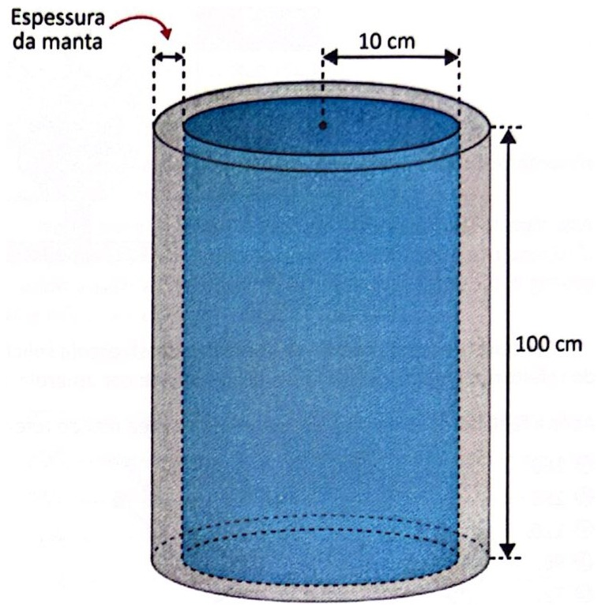

Essa equipe tem duas opções de material para a manta, cujas espessuras e preços estão apresentados no quadro.

| Material | Espessura da manta (cm) | Preço (a cada $1\,000\ \text{cm}^3$) |
|:---:|:---:|:---:|
| I | 1,0 | R$ 26,00 |
| II | 2,0 | R$ 12,00 |

Utilize 3 como aproximação para π.

A equipe terá menor custo na compra da manta cilíndrica se optar pelo material

**A)** I, apenas por apresentar a menor espessura.

**B)** I, pois apresenta um custo inferior ao do material II em R$ 6,60.

**C)** II, apenas por apresentar o menor preço por centímetro cúbico.

**D)** II, pois apresenta um custo inferior ao do material I em R$ 2,00.

**E)** II, pois apresenta um custo inferior ao do material I em R$ 5,40.

## Questão 166

Uma arquiteta elaborou um projeto para a construção de uma escola, cuja planta baixa está apresentada sobre uma malha quadriculada, conforme figura.

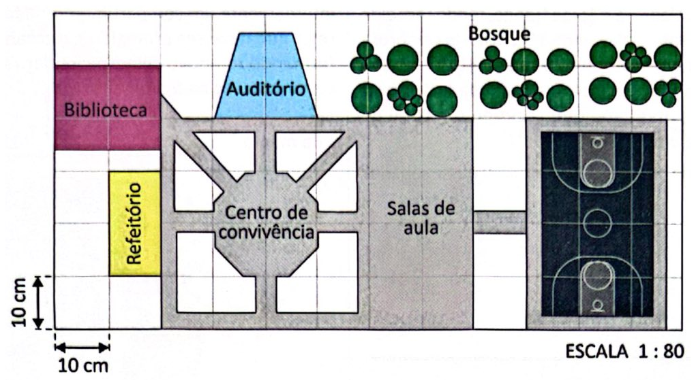

Por questões orçamentárias, a direção dessa escola solicitou que o projeto fosse modificado, reduzindo em 25% a área real do refeitório, que se encontra em destaque, de cor amarela, na figura.

Após a reelaboração do projeto, a medida da área real do refeitório, em metro quadrado, será

**A)** 160.

**B)** 150.

**C)** 120.

**D)** 96.

**E)** 72.

## Questão 167

No Brasil, datas são registradas no formato DD/MM, em que os primeiros dois dígitos codificam o dia do mês, e os dois seguintes, o mês do ano. Em alguns países, esses registros se dão no formato MM/DD, no qual se indica primeiro o mês do ano e depois o dia do mês. Por exemplo, a data 9 de maio é registrada, no Brasil, no formato 09/05, enquanto em alguns países, essa mesma data é registrada no formato 05/09.

Um aplicativo gerará aleatoriamente uma data (dia e mês) de um ano não bissexto.

Qual é a probabilidade de que a data gerada tenha o mesmo registro nos dois formatos considerados?

**A)** $\dfrac{12}{365}$

**B)** $\dfrac{30}{365}$

**C)** $\dfrac{144}{365}$

**D)** $\dfrac{1}{12}$

**E)** $\dfrac{12}{30}$

## Questão 168

Um jogo envolve blocos retangulares congruentes empilhados. A figura representa a configuração do empilhamento em uma etapa do jogo, de forma que uma das faces de cada bloco está paralela ao plano $\alpha$, que é perpendicular ao plano $\beta$ da base. Faces verticais de mesma cor estão em um mesmo plano.

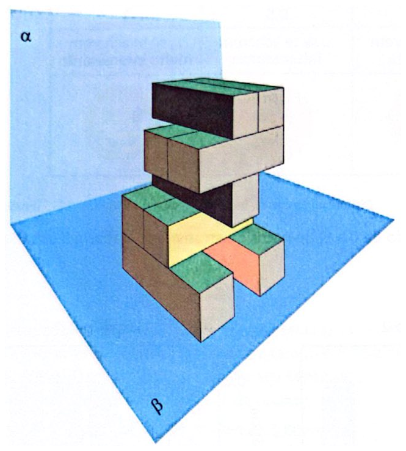

A figura que representa a projeção ortogonal desse empilhamento sobre o plano $\alpha$ é

**A)** 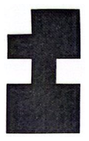

**B)** 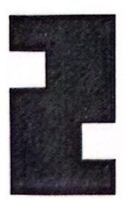

**C)** 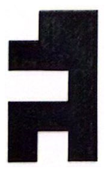

**D)** 

**E)** 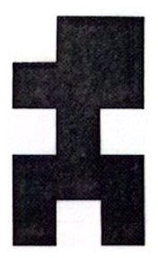

## Questão 169

Um teste, composto por 5 questões de múltipla escolha, com 5 alternativas de resposta por questão, valendo 1 ponto cada questão, foi aplicado a candidatos de um concurso. Esses candidatos foram classificados em 6 grupos, de acordo com suas notas nesse teste.

- N0: candidatos com nota 0.
- N1: candidatos com nota 1.
- N2: candidatos com nota 2.
- N3: candidatos com nota 3.
- N4: candidatos com nota 4.
- N5: candidatos com nota 5.

Todos os candidatos marcaram uma única alternativa de resposta em cada questão.

No Gráfico 1, estão descritas as porcentagens com que cada grupo marcou cada alternativa de resposta na questão 1, ficando ausentes as informações dos percentuais dos grupos N4 e N5, que marcaram a alternativa D.

**Gráfico 1 – Porcentagens de escolhas de alternativas na questão 1, por grupo**

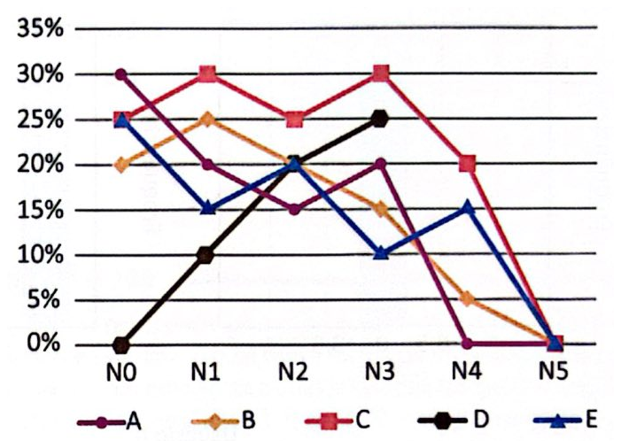

No Gráfico 2, está apresentada a distribuição dos candidatos por grupo.

**Gráfico 2 – Distribuição dos candidatos por grupo**

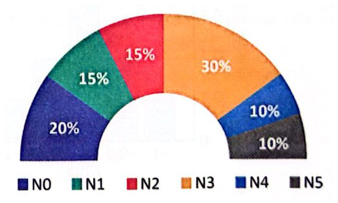

Qual é o percentual de candidatos que acertou a questão 1?

**A)** 10%

**B)** 12%

**C)** 16%

**D)** 25%

**E)** 28%

## Questão 170

A matemática britânica Hannah Fry explica o falso paradoxo de pessoas com a mesma nota média de atratividade em sites de relacionamento terem diferentes graus de popularidade. Segundo Fry, a popularidade de um usuário desse tipo de site não está relacionada apenas à sua nota média de atratividade, mas também à dispersão das notas. Quanto maior o desvio padrão de suas notas, maior é a sua popularidade. Essas notas podem ser:

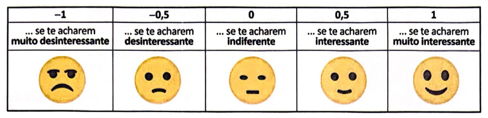

> Disponível em: www.ted.com. Acesso em: 16 maio 2015 (adaptado).

Os gráficos a seguir apresentam as frequências relativas (variando de 0 a 1) de notas de atratividade dadas a 5 usuários de um site de relacionamento.

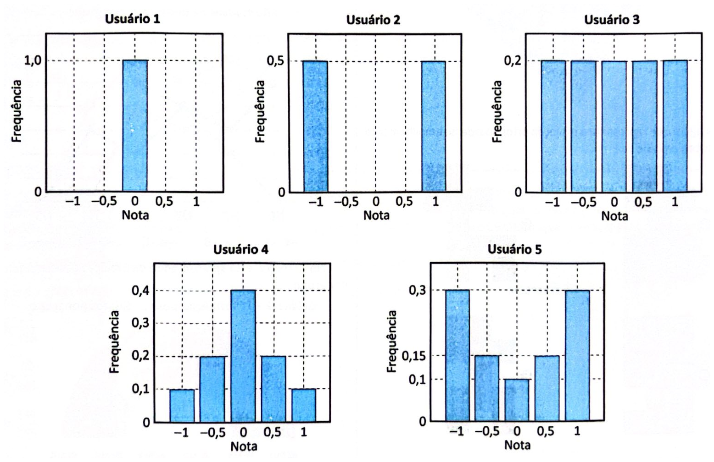

Segundo o critério apresentado por Hannah Fry, o usuário com maior popularidade é o

**A)** 1.

**B)** 2.

**C)** 3.

**D)** 4.

**E)** 5.

## Questão 171

O tampo de uma mesa tem o formato da região de cor amarela na figura. Essa região é obtida pela intersecção de três círculos com centros nos pontos *A*, *B* e *C*, respectivamente, e raios de medidas iguais a 1,20 m.

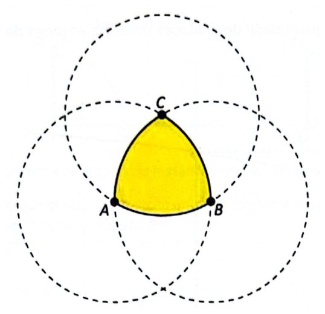

Para cobrir essa mesa, pretende-se comprar uma toalha, com a menor área possível, que cubra o tampo e o exceda em pelo menos 20 cm ao longo de todo o seu contorno.

Em uma loja há cinco modelos de toalhas:

I. círculo com diâmetro de medida 1,60 m;  
II. círculo com diâmetro de medida 1,76 m;  
III. quadrado com lados de medida 1,60 m;  
IV. quadrado com lados de medida 1,76 m;  
V. triângulo equilátero com lados de medida 1,60 m.

Utilize 1,7 como aproximação para $\sqrt{3}$.

O modelo a ser comprado é o

**A)** I.

**B)** II.

**C)** III.

**D)** IV.

**E)** V.

## Questão 172

O volume de água armazenado em um reservatório é dado pela soma do volume útil com o volume de reserva técnica. O volume de reserva técnica só pode ser utilizado após a água do volume útil acabar.

> Disponível em: www2.sabesp.com.br. Acesso em: 2 dez. 2017 (adaptado).

Em determinado momento, o reservatório de uma cidade conta com um volume útil de 480 milhões de metros cúbicos e um volume de reserva técnica de 30 milhões de metros cúbicos. Ao se calcular o consumo médio diário de água, concluiu-se que, em um cenário em que o reservatório não seja reabastecido, todo o volume de água armazenado no reservatório seria utilizado em um período de 30 dias. Considerando-se esse cenário, estabeleceu-se a necessidade de redução do volume médio diário de água fornecida atualmente de modo que, ao final desse período de 30 dias, ainda restasse 25% do volume útil no reservatório, além do volume de reserva técnica.

Qual deve ser a redução do volume médio diário de água fornecida, em milhão de metros cúbicos, para atender ao que foi estabelecido?

**A)** 5,25

**B)** 5,00

**C)** 4,25

**D)** 4,00

**E)** 3,00

## Questão 173

Um pai pretende pintar as quatro paredes e o teto do quarto de sua filha, o qual tem a forma de paralelepípedo reto retângulo, com uma porta e duas janelas de formato retangular. A porta tem dimensões de 1 m por 2,20 m; e as janelas, de 1,5 m por 1 m cada. Ele contrata um pintor e informa que a área a ser pintada mede 41,7 m². O pintor pede detalhes do quarto, e o pai informa as medidas da porta e das janelas, que não serão pintadas. Quanto às dimensões do quarto, a medida da altura é 2,8 m e a da largura é 3 m, mas o pai não se recorda da medida do comprimento do quarto.

A medida do comprimento do quarto, em metro, é

**A)** 2,8.

**B)** 3,5.

**C)** 4,4.

**D)** 5,1.

**E)** 5,3.

## Questão 174

O gráfico registra, sobre uma malha quadriculada, as quantidades de unidades habitacionais vendidas em um município, nos dois primeiros meses do ano, e a curva que fornece a estimativa *E* da quantidade de unidades vendidas nesse município, para o segundo semestre do mesmo ano, descrita pela função

$E(n) = 1\,500 + 2\,000 \times \log_{10}(1 + n)$, com $6 \leq n \leq 12$,

sendo *n* o número que identifica o mês. Por exemplo, a estimativa da quantidade de unidades vendidas ao longo do mês de agosto é $E(8) = 1\,500 + 2\,000 \times \log_{10}(1 + 8)$.

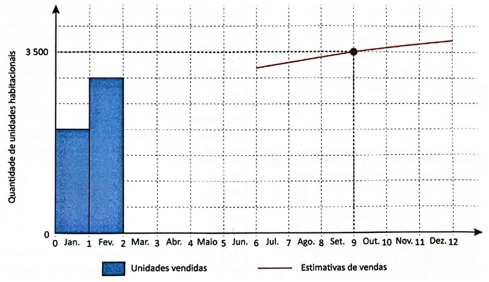

Ao final do primeiro bimestre, calculou-se a média mensal de unidades vendidas nesse período e, para projetar o crescimento das vendas nesse ano, estimou-se a média mensal de unidades habitacionais que serão vendidas no último bimestre desse ano comparando-se essas duas médias.

Utilize $\log_{10} 12 = 1{,}079$ e $\log_{10} 13 = 1{,}114$.

Em quantas unidades a média de vendas estimada para o último bimestre superou a média calculada do primeiro bimestre?

**A)** 1 079

**B)** 1 193

**C)** 3 688

**D)** 10 000

**E)** 20 000

## Questão 175

Uma câmera *P*, com ângulo de visão de 90°, leva 30 segundos para se deslocar do ponto *M* ao ponto *N*, no sentido horário e em velocidade angular constante, sobre um trilho em formato de um quarto de circunferência, com 2 m de raio e centro no ponto *O*. Ao iniciar o movimento, ela é ligada e inicia a captura da imagem do segmento *OT*, que é parte da semirreta *s*, que tem origem no ponto *O* e é perpendicular ao segmento *OM*, conforme os esquemas.

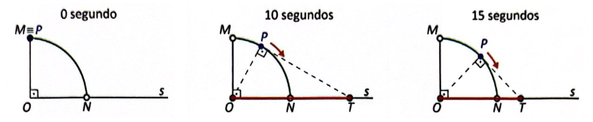

A câmera é desligada no instante em que chega ao ponto *N*.

O gráfico que descreve a relação entre o comprimento *c*, em metro, do segmento *OT*, e o tempo *t*, em segundo, durante o período em que a câmera fica ligada é

**A)** 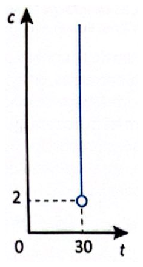

**B)** 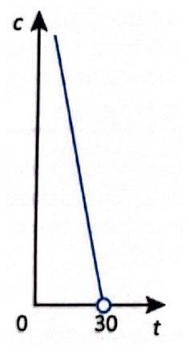

**C)** 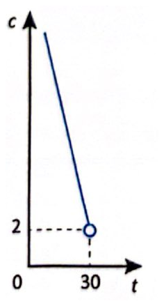

**D)** 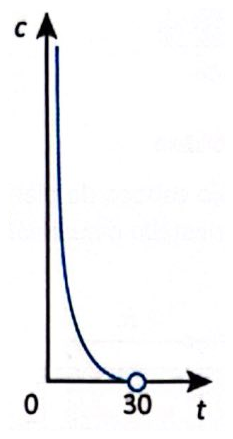

**E)** 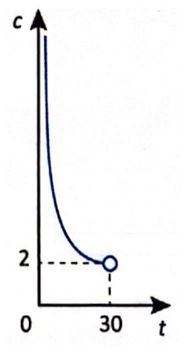

## Questão 176

A Figura 1 mostra a vista superior de um mobiliário de cozinha, que não pode ser desmembrado, montado na casa de um engenheiro.

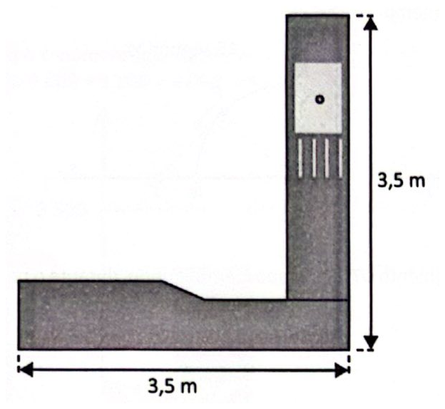

**Figura 1**: Vista superior do mobiliário

Ele mudará para um apartamento, cujo esboço de planta baixa está dado na Figura 2, onde pretende instalar o mobiliário na nova cozinha.

**Figura 2**: Planta baixa para reforma

Como a cozinha do apartamento é muito pequena, decidiu ampliá-la, avançando-a sobre as áreas da sala e do quarto, de modo a manter os formatos retangulares tanto da cozinha quanto do quarto, apenas o necessário para caber o mobiliário da Figura 1 na nova cozinha.

Após essa reforma, as medidas das áreas, em metro quadrado, da sala e do quarto, serão

**A)** 9,75 e 37,50.

**B)** 9,75 e 16,00.

**C)** 19,00 e 10,75.

**D)** 19,75 e 10,00.

**E)** 2,00 e 3,75.

## Questão 177

Na história da arte brasileira, não há obra tão valiosa quanto o *Abaporu*, criada em 1928 por Tarsila do Amaral. A figura apresenta essa obra e suas dimensões originais.

> AMARAL, Tarsila do. **Abaporu**. Óleo sobre tela, 85 cm × 73 cm. Museu de Arte Latino-Americana de Buenos Aires, Buenos Aires, 1928.

Uma editora pretende lançar um álbum de figurinhas com as obras de arte brasileira mais famosas e, entre elas, está essa obra de Tarsila do Amaral. O álbum tem um espaço destinado para colar a figurinha da obra *Abaporu*, em formato retangular, cuja área mede 62,05 cm² e com dimensões proporcionais às da obra de arte original. Após a colagem, essa figurinha deve preencher totalmente o espaço a ela destinado.

Essa obra será representada pela figurinha na escala

**A)** 1 : 2,5

**B)** 1 : 3,9

**C)** 1 : 5

**D)** 1 : 10

**E)** 1 : 100

## Questão 178

Uma motocicleta tem duas rodas de tamanhos diferentes: a dianteira, com diâmetro externo medindo 0,8 m e, a traseira, cujo diâmetro externo mede 0,6 m. Essa motocicleta foi conduzida por um percurso retilíneo de 3 600 m.

Utilize 3 como aproximação para $\pi$.

Quantos giros completos a roda traseira deu a mais que a dianteira quando a motocicleta concluiu esse percurso?

**A)** 500

**B)** 1 000

**C)** 1 500

**D)** 2 917

**E)** 5 833

## Questão 179

No esquema estão representadas cinco cidades, P, Q, R, S e T, e todas as estradas que conectam as cidades P a Q e S a T. As estradas que conectam as cidades Q a R e R a S foram omitidas no esquema, porém sabe-se que há mais estradas conectando Q a R do que R a S.

Será realizada uma viagem saindo da cidade P até a cidade T, passando pelas cidades Q, R e S, nessa ordem. Há um total de 30 possíveis rotas para fazer essa viagem.

A quantidade de estradas que conectam a cidade Q à cidade R é

**A)** $\dfrac{30}{3 \times 2}$

**B)** $\dfrac{30}{3 + 2}$

**C)** $\dfrac{30}{2}$

**D)** $30 - (3 \times 2)$

**E)** $30 - (3 + 2)$

## Questão 180

Um colchão deve ser adequado ao biotipo de cada pessoa, sendo confortável e ao mesmo tempo capaz de suportar o peso do corpo. O quadro apresenta as opções recomendadas da densidade (D) do colchão para diversos biotipos, consideradas a massa e a altura da pessoa. Caso existam duas opções de densidade recomendadas para um mesmo biotipo, a apresentada em negrito indica a que é mais adequada.

![Quadro de densidades por Massa (quilograma) e Altura (metro) — colunas Até 1,50; 1,51 a 1,60; 1,61 a 1,70; 1,71 a 1,80; 1,81 a 1,90; Acima de 1,90. Até 50: D-20; D-23; D-23; -; -; -. 51 a 60: D-23; D-23 (negrito) ou D-26; D-26 (negrito) ou D-28; D-28; -; -. 61 a 70: D-26; D-26 (negrito) ou D-28; D-26 (negrito) ou D-28; D-28 (negrito) ou D-30; D-30; -. 71 a 80: -; D-28; D-28 (negrito) ou D-30; D-30 (negrito) ou D-33; D-30 (negrito) ou D-33; D-33. 81 a 90: -; -; D-30; D-30 (negrito) ou D-33; D-30 (negrito) ou D-33; D-33 (negrito) ou D-36. 91 a 100: -; -; D-33; D-33; D-33; D-36](imagens/q180_fig1.png)

> Disponível em: www.inmetro.gov.br. Acesso em: 28 fev. 2012 (adaptado).

Uma pessoa com 71 kg de massa e 1,71 m de altura precisa adquirir um novo colchão.

A densidade mais adequada de um colchão para essa pessoa é

**A)** D-26.

**B)** D-28.

**C)** D-30.

**D)** D-33.

**E)** D-36.

