# Física · ENEM 2026 — 2º dia — Caderno 5 · Amarelo

Questões da **Prova de Ciências da Natureza e suas Tecnologias** que envolvem conceitos de Física, com a
**numeração original** do caderno: 91, 92, 94, 95, 96, 99, 104, 111, 113, 114, 118, 121, 128, 130, 133.

Transcrição do caderno escaneado (fonte: "ENEM 2 dia - Prova Amarela Anglo Resolve.pdf"). Figuras recortadas da prova
original em `imagens/`. Fórmulas em LaTeX (`$...$`).

---

## Questão 91

O modelo de Rutherford para o átomo consiste em um núcleo bastante denso, pequeno e carregado positivamente, ao redor do qual orbitam partículas negativas. A interação atrativa entre o núcleo e os elétrons foi explicada posteriormente pela existência de uma força centrípeta de origem elétrica, cujo módulo, segundo a lei de Coulomb, é proporcional à constante eletrostática e ao quadrado da carga elementar, e inversamente proporcional ao quadrado da distância entre o núcleo e os elétrons. No entanto, o modelo planetário proposto por Rutherford não concorda com a teoria eletromagnética clássica, segundo a qual os elétrons descreveriam um movimento em espiral e se chocariam com o núcleo, o que não corresponde à realidade.

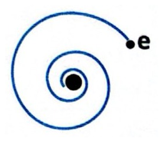

Qual gráfico apresenta a força de atração entre o núcleo e o elétron, em função do tempo para o átomo de hidrogênio, levando em consideração a teoria eletromagnética clássica?

**A)** 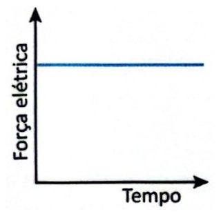

**B)** 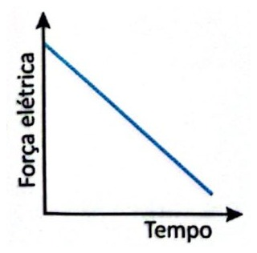

**C)** 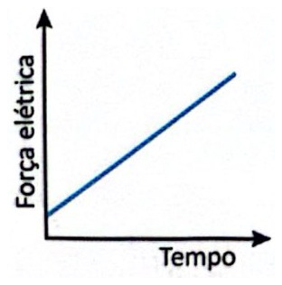

**D)** 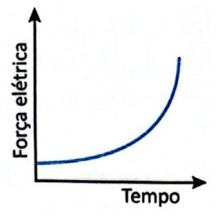

**E)** 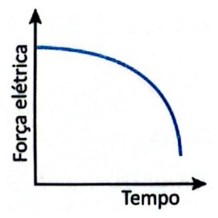

## Questão 92

O quadro lista o resultado da simulação feita por uma engenheira para dimensionar as fontes de calor no interior de um escritório onde trabalham 20 pessoas. Todos os equipamentos e as pessoas dissipam calor de acordo com os valores no quadro. Para manter constante a temperatura do escritório, ela precisa de um aparelho de ar-condicionado o mais econômico possível. Considere as paredes isolantes e o fator de conversão 1 Btu/h = 0,3 W.

| Fonte de calor | Quantidade | Potência individual (W) |
|---|---|---|
| Lâmpada | 10 | 100 |
| Computador | 20 | 150 |
| Geladeira | 2 | 500 |
| Pessoa adulta | 20 | 200 |

Qual é a capacidade de refrigeração, em British thermal unit por hora, do aparelho selecionado?

**A)** 7 000 Btu/h

**B)** 10 000 Btu/h

**C)** 12 000 Btu/h

**D)** 24 000 Btu/h

**E)** 30 000 Btu/h

## Questão 94

Em um reator de fusão nuclear, é necessário produzir plasma a um milhão de graus centígrados para desencadear reações de fusão nuclear controladas. O plasma é formado por um gás ionizado que contém inicialmente deutério $D^{+}$ e trítio $T^{+}$ (isótopos do hidrogênio, com um e dois nêutrons, respectivamente). Nesse plasma, a energia térmica é suficientemente alta para desencadear uma reação de fusão nuclear na qual o núcleo do deutério, partícula $D^{+}$, e o núcleo de trítio, partícula $T^{+}$, colidem para formar uma partícula $\alpha$ e um nêutron *n*. A representação dessa reação de fusão é

$$D^{+} + T^{+} \longrightarrow \alpha + n$$

A partícula $\alpha$ é formada por dois prótons e dois nêutrons. A energia liberada pela fusão é dividida na forma de energia cinética entre a partícula $\alpha$ e o nêutron *n*. Considere as massas do próton e do nêutron iguais, que o momento linear total das partículas reagentes é nulo e também que a energia cinética dos produtos é de 20 MeV.

> Disponível em: www.scientificamerican.com. Acesso em: 11 nov. 2019 (adaptado).

Nessa reação de fusão, a energia cinética do nêutron, em megaelétron-volt, é

**A)** 4,0 MeV.

**B)** 10 MeV.

**C)** 13 MeV.

**D)** 15 MeV.

**E)** 16 MeV.

## Questão 95

A mudança da resistência elétrica de alguns materiais em função da temperatura é utilizada para construir sensores que podem medir desde a temperatura ambiente até a de fornos. A figura representa um circuito elétrico usado para fazer a correspondência entre temperatura e tensão elétrica, na qual a resistência elétrica $R_s$ varia com a temperatura segundo a expressão $R_s = 20[1 + 0{,}002(T - 300)]$. A temperatura é medida em Kelvin.

A tensão elétrica, em volt, entre os pontos **A** e **B** da figura, quando o sensor estiver à temperatura de 800 K é de

**A)** 5,0 V.

**B)** 4,0 V.

**C)** 3,0 V.

**D)** 2,0 V.

**E)** 1,0 V.

## Questão 96

Uma instalação de radar, usada para rastrear aviões, emite ondas eletromagnéticas com velocidade estimada de 300 mil quilômetros por segundo. Um avião que saiu da rota foi localizado em um raio de 75 quilômetros do aeroporto onde fica o radar. O operador usou o tempo dispendido para enviar e receber a resposta com a finalidade de estimar a localização do avião.

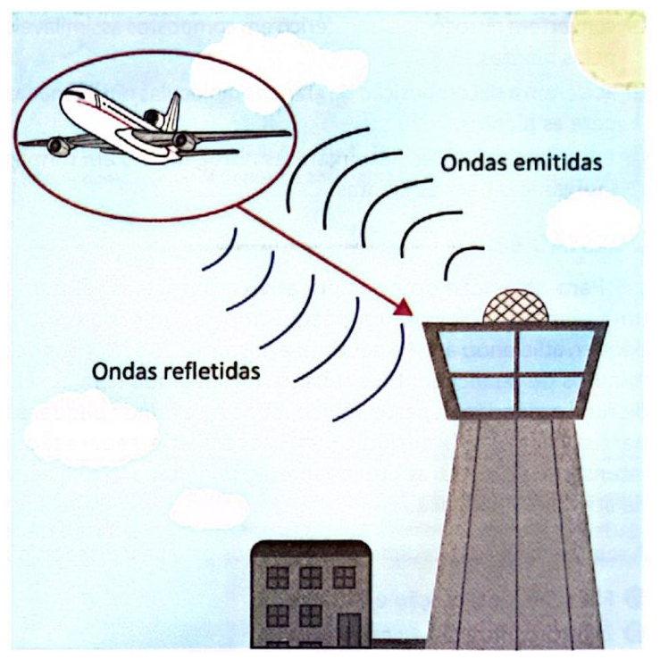

> Disponível em: www.pasternack.com. Acesso em: 1 abr. 2026 (adaptado).

O tempo, em segundo, medido foi de

**A)** $2{,}0 \times 10^{3}$ s.

**B)** $4{,}0 \times 10^{0}$ s.

**C)** $5{,}0 \times 10^{-1}$ s.

**D)** $1{,}5 \times 10^{-3}$ s.

**E)** $5{,}0 \times 10^{-4}$ s.

## Questão 99

Em uma maquete de uma sala, foram instaladas duas lâmpadas (A e B) nas paredes e duas lâmpadas (C e D) no teto, conforme a figura. Essas lâmpadas são alimentadas por duas baterias idênticas em série. Todas as lâmpadas são incandescentes e brilham igualmente quando conectadas individualmente a uma das baterias. Considere ideais todos os elementos do circuito. Os amperímetros indicam a corrente elétrica que passa no fio no qual estão inseridos.

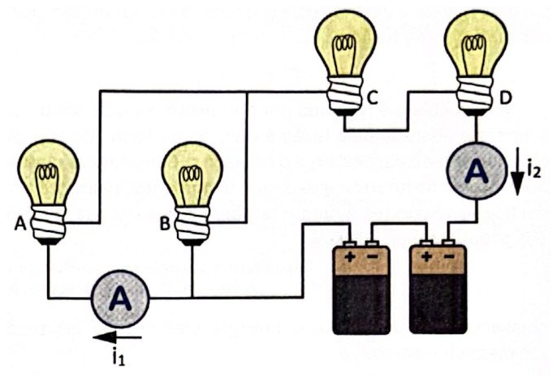

As correntes medidas nos amperímetros serão iguais e não nulas quando a(s)

**A)** lâmpadas A, B, C e D estiverem ligadas.

**B)** lâmpada A estiver queimada.

**C)** lâmpada B estiver queimada.

**D)** lâmpada C estiver queimada.

**E)** lâmpada D estiver queimada.

## Questão 104

A água é uma substância essencial à vida e pode ser encontrada na natureza em três estados físicos: sólido, líquido e gasoso. As propriedades físico-químicas que definem cada um desses estados estão representadas no diagrama de fases, em que as curvas em vermelho representam o estado de equilíbrio entre duas fases. Por meio dele, é possível determinar qual é o estado físico de uma substância em um dado valor de pressão (p) e de temperatura (T).

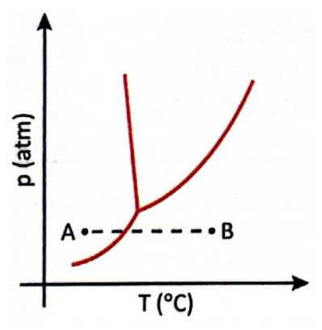

> ATKINS, Peter; JONES, Loretta. **Princípios de química:** questionando a vida moderna e o meio ambiente. Porto Alegre: Bookman, 2006 (adaptado).

Qual é a mudança de estado físico que ocorre com a água quando, à pressão constante, a temperatura varia de A para B ao longo do trajeto tracejado?

**A)** Fusão, a água muda do estado sólido para o líquido.

**B)** Ebulição, a água muda do estado líquido para o gasoso.

**C)** Sublimação, a água muda do estado sólido para o gasoso.

**D)** Solidificação, a água muda do estado líquido para o sólido.

**E)** Condensação, a água muda do estado gasoso para o líquido.

## Questão 111

A busca por fontes alternativas de energia é uma das grandes preocupações da humanidade devido ao possível esgotamento dos combustíveis fósseis e à degradação ambiental causada por eles. Como a demanda de energia cresce significativamente, há um grande investimento em outros tipos de geração de energia, tais como hidrelétrica, nuclear, solar, termelétrica a biomassa e eólica.

> BIZERRA, Ayla M. C.; QUEIROZ, Jorge L. A.; COUTINHO, Demétrios A. M. O impacto ambiental dos combustíveis fósseis e dos biocombustíveis: as concepções de estudantes do ensino médio sobre o tema. **Revbea**, n. 3, 2018 (adaptado).

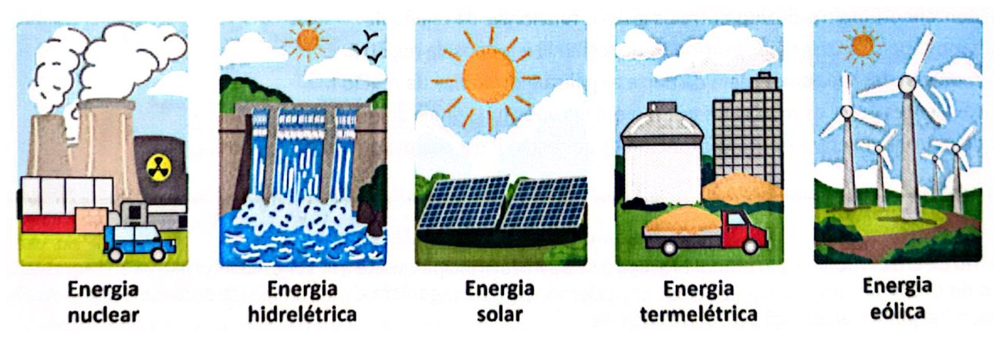

Dentre as fontes de energia citadas, o tipo de energia oriunda de uma fonte não renovável, que independe das condições climáticas para ser obtida, é a

**A)** nuclear, gerada pela fissão nuclear do urânio.

**B)** hidrelétrica, gerada pela movimentação da água.

**C)** solar, gerada pelo uso de células fotovoltaicas.

**D)** termelétrica, produzida pela combustão de biomassa.

**E)** eólica, produzida pelo movimento das pás de aerogeradores.

## Questão 113

O comprimento da parte oscilante da corda de um violão determina a nota musical emitida. No braço do violão, são colocadas peças metálicas espaçadas chamadas trastes. Quando as cordas são pressionadas entre os trastes, os comprimentos de suas partes oscilantes são reduzidos, gerando ondas de diferentes frequências. Algumas notas com os valores aproximados de suas frequências são apresentadas no quadro. A figura ilustra um violão com cordas de comprimento total vibrante ($L_T$) igual a 60 cm. Considere o modo de vibração fundamental ($n = 1$) e que as frequências de vibração são inversamente proporcionais ao comprimento da parte oscilante da corda. Sabe-se que a primeira corda oscila com frequência de 660 Hz (a nota mi) quando não pressionada (corda livre).

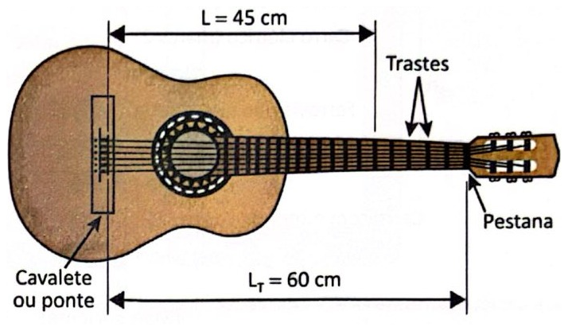

**Frequência das notas musicais, em hertz, no sistema temperado**

| Oitava | Dó | Ré | Mi | Fá | Sol | Lá | Si |
|:-:|:-:|:-:|:-:|:-:|:-:|:-:|:-:|
| 3ª | 130 | 147 | 165 | 175 | 196 | 220 | 248 |
| 4ª | 260 | 294 | 330 | 349 | 392 | 440 | 495 |
| 5ª | 520 | 587 | 660 | 698 | 784 | 880 | 990 |
| 6ª | 1 040 | 1 174 | 1 320 | 1 397 | 1 568 | 1 760 | 1 980 |

> OLIVEIRA, Leonardo M.; VEIT, Eliane A.; SCHNEIDER, Claúdio. **Oitavas e notas**. Disponível em: www.if.ufrgs.br. Acesso em: 6 nov. 2023 (adaptado).

Ao pressionar a primeira corda, de forma que a sua parte oscilante tenha 45 centímetros, e fazê-la vibrar, qual é a nota emitida pela corda?

**A)** Dó.

**B)** Mi.

**C)** Sol.

**D)** Lá.

**E)** Si.

## Questão 114

Uma fabricante de automóveis anunciou o plano de eletrificar toda a sua frota até o ano 2030. Determinado protótipo é parte fundamental dessa estratégia por ter autonomia de 1 000 km e um gasto energético de 1 kWh para cada 10 km, quando ocupado por quatro pessoas. O gráfico apresenta, para vários meios de transporte, o gasto energético por passageiro, considerado como um dos fatores determinantes para o desenvolvimento de políticas públicas de regulação dos meios de transporte.

> Disponível em: https://quatrorodas.abril.com.br. Acesso em: 2 dez. 2021 (adaptado).

De acordo com o gráfico, quantos meios de transporte apresentam maior eficiência energética que esse protótipo?

**A)** 1

**B)** 2

**C)** 4

**D)** 5

**E)** 7

## Questão 118

A figura ilustra uma forma de medir a densidade relativa de dois líquidos, A e B, imiscíveis, colocando-os em um tubo em forma de U. Atingido o equilíbrio hidrostático, medem-se as alturas, $h_{A1}$ e $h_{B1}$, das colunas dos líquidos, a partir de sua superfície até o nível da linha de separação entre eles. Considere que um volume adicional de líquido A é colocado na coluna esquerda do tubo, conforme a figura. Após o equilíbrio ser restabelecido, medem-se as novas alturas, $h_{A2}$ e $h_{B2}$, da mesma maneira, comparando-as com as alturas anteriores.

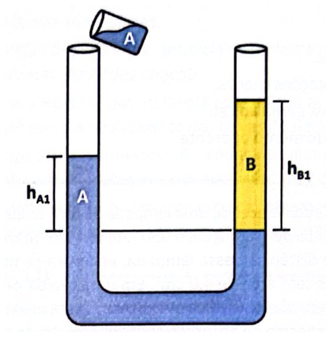

A comparação entre as novas alturas e as anteriores revela que

**A)** $h_{A2} = h_{A1}$ e $h_{B2} = h_{B1}$.

**B)** $h_{A2} > h_{A1}$ e $h_{B2} = h_{B1}$.

**C)** $h_{A2} > h_{A1}$ e $h_{B2} > h_{B1}$.

**D)** $h_{A2} < h_{A1}$ e $h_{B2} > h_{B1}$.

**E)** $h_{A2} = h_{A1}$ e $h_{B2} > h_{B1}$.

## Questão 121

Um estudante acende uma lâmpada de 6 W de luz vermelha (comprimento de onda igual a 650 nm) em um quarto escuro. A 1,0 m de distância dessa lâmpada, encontra-se uma planta cujas folhas têm área de $4{,}0\ \text{cm}^2$. Em uma rápida pesquisa na internet, o estudante verifica que plantas dessa mesma espécie possuem espectro de absorção conforme ilustrado no gráfico, que apresenta a porcentagem de luz incidente absorvida em função do comprimento de onda.

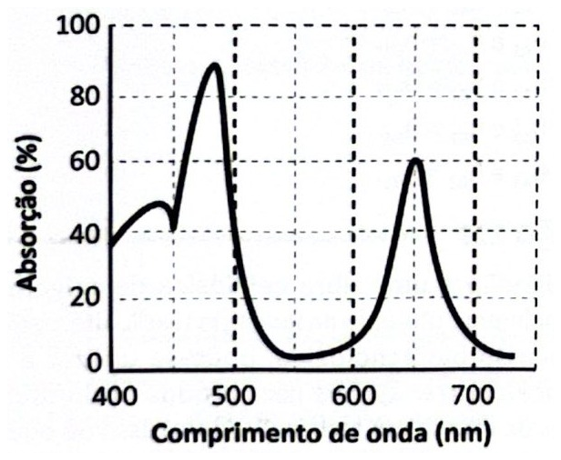

Considere a lâmpada como uma fonte puntiforme cuja intensidade luminosa é dada pela razão entre a sua potência e a área da superfície esférica formada a uma distância *r* da fonte.

Utilize 3 como valor aproximado para π.

Com base nessas informações e no gráfico, qual é o valor mais próximo da energia, em joule, que cada folha absorverá a cada segundo?

**A)** $3{,}8 \times 10^{-4}$ J

**B)** $4{,}8 \times 10^{-4}$ J

**C)** $2{,}0 \times 10^{-4}$ J

**D)** $1{,}8 \times 10^{-4}$ J

**E)** $1{,}2 \times 10^{-4}$ J

## Questão 128

Ao trafegar à noite, é necessário manter os faróis dos veículos acesos. Quando a umidade relativa do ar é baixa, o motorista consegue ter boa visibilidade da pista. No entanto, em noites em que há neblina, essa visibilidade é reduzida.

Nessa situação, a visibilidade reduzida deve-se à

**A)** dispersão da luz pelas gotículas de água suspensas no ar.

**B)** polarização da luz pelas gotículas de água dispersas no ar.

**C)** condensação das gotículas de água na superfície do farol.

**D)** solubilização das gotículas de água presentes no ar.

**E)** redução da potência da luz emitida pelo farol.

## Questão 130

Um jardineiro está irrigando as plantas de um jardim com uma mangueira. Ele estica completamente a mangueira para se aproximar de algumas flores mais afastadas, sem, no entanto, alcançá-las. Daí, ocorre-lhe que obstruir a extremidade da mangueira com o polegar faz com que o jato de água atinja uma distância maior, comparativamente com a situação sem essa ação, permitindo-lhe molhar aquelas flores mais afastadas.

Essa alteração no alcance do jato de água deve-se ao aumento do(a)

**A)** velocidade da água lançada.

**B)** densidade da água lançada.

**C)** volume da água lançada.

**D)** massa da água lançada.

**E)** vazão da água lançada.

## Questão 133

O quadro foi retirado de um manual que apresenta as especificações e a potência de um aparelho de TV.

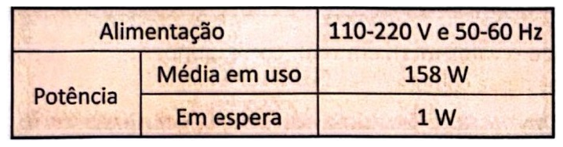

Se uma pessoa assistiu à TV durante 4 horas e no restante do dia o aparelho permaneceu em espera, qual é a porcentagem da energia utilizada em espera quando comparada com o total de energia utilizado?

**A)** 0,2%

**B)** 0,6%

**C)** 1,0%

**D)** 3,0%

**E)** 20%

